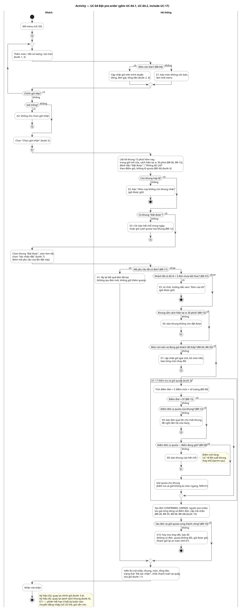
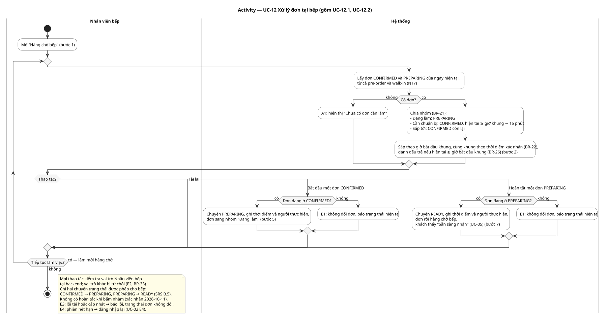

# Activity Diagrams
Trạng thái: Lập ở task T-06 (Sprint 1) ngày 2026-10-12 cho hai luồng Sprint 1; người dùng chưa review.

Mỗi sơ đồ phải tham chiếu một hoặc nhiều Use Case và thể hiện:

- điểm bắt đầu/kết thúc;
- action của actor và system;
- decision, guard condition, branch và merge;
- luồng lỗi hoặc luồng thay thế quan trọng.

Quy ước tên file: `UC-xxx_<short-name>_activity.<ext>`, trong đó `xxx` là mã use case của dự án (2 chữ số, ví dụ `UC-04`).

Input: [Use Case Specification](../Use-Cases/README.md) mục 5. Thực hiện theo Bước 10 của [quy trình IT3180](../../../00-References/IT3180_PROJECT_PROCESS.md).

## 1. UC-04 Đặt pre-order
Từ [đặc tả UC-04](../Use-Cases/specifications/UC-04-dat-pre-order.md), gồm UC-04.1 giỏ hàng, UC-04.2 chọn khung và gửi đơn, và vùng UC-17 Kiểm tra và giữ quota ([đặc tả](../Use-Cases/specifications/UC-17-kiem-tra-va-giu-quota.md)). Hai cột: Khách, Hệ thống.



| Nhánh trên sơ đồ | Luồng trong đặc tả | Kết thúc / quay về |
|---|---|---|
| Món còn bán? → không | E1 | Tiếp tục chỉnh giỏ |
| Giỏ trống? → có | A2 | (G) |
| Còn khung hợp lệ? → không | E2 | Kết thúc |
| Có khung "Đặt được"? → không | E3, E4 | (G) |
| Mã yêu cầu đã có đơn? → có | A1 | Hiển thị kết quả đơn cũ |
| Đủ N = 3 đơn chưa kết thúc? → có | E5 | Kết thúc |
| Khung vẫn ≥ 30 phút? → không | E6 | (K) |
| Món còn bán và đúng giá? → không | E7 | (G) |
| Điểm đơn ≤ quota của khung? → không | E9 (UC-17 E1) | (G) |
| Điểm đơn ≤ quota − đang giữ? → không | E8 (UC-17 E2), điểm mở rộng UC-18 | (K) |
| Tạo đơn và giữ quota cùng thành công? → không | E10 (UC-17 E3) | Kết thúc |
| Ghi chú | E11 phiên hết hạn | Đăng nhập lại |

Có 3 điểm kết thúc không thành công (E2, E5, E10) và 1 điểm kết thúc thành công; ngoài ra khách có thể bỏ dở ở bất kỳ bước nào. Đường thành công ngắn nhất: thêm món → chọn giờ → chọn khung → mọi kiểm tra đạt → giữ quota → tạo đơn → hiển thị mã nhận.

## 2. UC-12 Xử lý đơn tại bếp
Từ [đặc tả UC-12](../Use-Cases/specifications/UC-12-xu-ly-don-tai-bep.md), gồm UC-12.1 xem hàng chờ và UC-12.2 cập nhật tiến độ. Hai cột: Nhân viên bếp, Hệ thống.



| Nhánh trên sơ đồ | Luồng trong đặc tả |
|---|---|
| Có đơn? → không | A1 |
| Đơn đang ở CONFIRMED? / PREPARING? → không | E1 (trạng thái đã đổi, ví dụ hai người bếp cùng bấm) |
| Ghi chú | E2 sai vai trò, E3 lỗi tải/cập nhật, E4 phiên hết hạn |

## Cách đọc sơ đồ
| Ký hiệu | Nghĩa |
|---|---|
| Chấm đen / chấm đen có viền | Bắt đầu / kết thúc |
| Hộp bo góc | Hành động (action), ghi bước và quy tắc BR trong đặc tả |
| Hình thoi có câu hỏi | Quyết định; chữ trên mỗi nhánh là điều kiện (guard) |
| Hình thoi không chữ | Điểm gộp nhánh (merge) hoặc bắt đầu vòng lặp |
| Cột (swimlane) | Ai thực hiện hành động |
| Vùng có viền và tiêu đề | Phần thuộc use case được include (UC-17) |
| Vòng tròn có chữ (G), (K) | Connector: nhảy về vị trí có cùng chữ, thay cho dây vòng ngược |

Hai luồng "phiên hết hạn" và "sai vai trò" xảy ra ở mọi bước nên ghi trong ghi chú thay vì vẽ nhánh ở từng bước.

## Công cụ
Viết bằng PlantUML như sơ đồ Use Case; kiểu chung ở `_style.iuml`. Sửa file `.puml` rồi xuất lại SVG, trong thư mục này:
```bash
MSYS_NO_PATHCONV=1 docker run --rm -v "$(pwd -W 2>/dev/null || pwd):/data" plantuml/plantuml:1.2026.8 -tsvg -charset UTF-8 "/data/UC-*.puml"
```
Activity Diagram không cần Graphviz, nên khi Docker Desktop tắt có thể dùng Java: tải `plantuml-1.2026.8.jar` từ Maven Central (`net.sourceforge.plantuml:plantuml`), rồi `java -jar plantuml-1.2026.8.jar -tsvg -charset UTF-8 "UC-*.puml"`. Không commit file jar.

Lưu ý cú pháp: trong hộp hành động `:...;`, dấu `;` ở cuối dòng kết thúc hành động; viết nhiều dòng thì các dòng giữa không được kết thúc bằng `;`.

## Output chuyển giao
- T-07 Analysis/Sequence: các hành động của cột Hệ thống trong UC-04 và vùng UC-17 là input để phân bổ trách nhiệm Boundary/Controller/Entity.
- T-11 UI: các điểm Khách quyết định và các thông báo lỗi là input cho màn hình và điều hướng.
- T-23, T-24 Test Case: mỗi nhánh trong bảng mục 1, 2 là ít nhất một đường kiểm thử.
