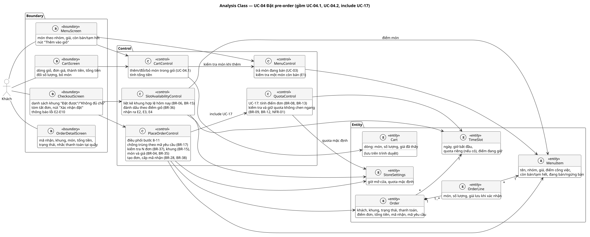
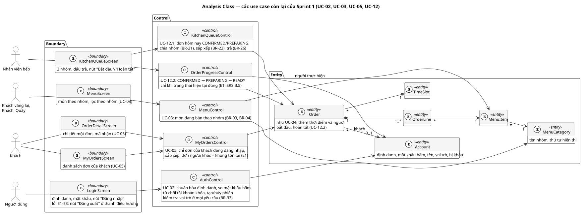
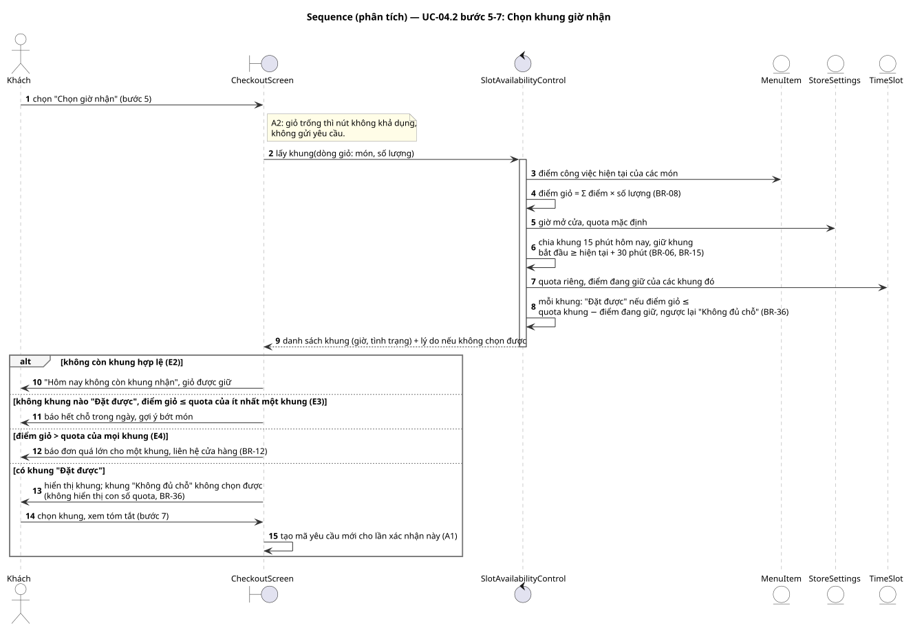
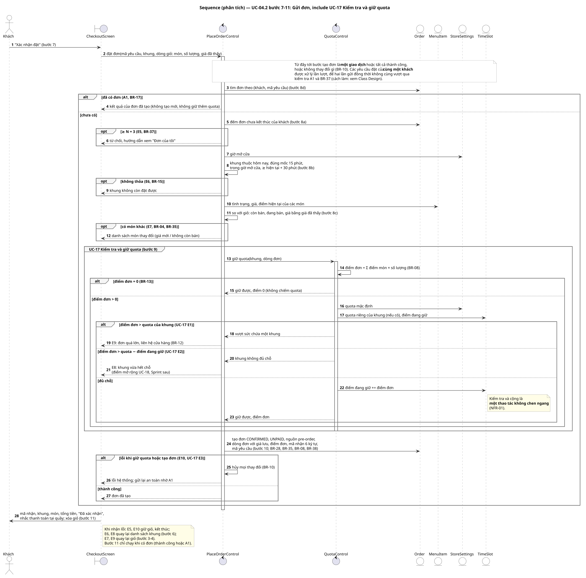

# Analysis Model
Trạng thái: Lập ở task T-07 (Sprint 1) ngày 2026-10-17 cho các use case Sprint 1, trọng tâm UC-04 Đặt pre-order có giữ quota (UC-17); người dùng chưa review.

Bước 11 của [quy trình IT3180](../../../00-References/IT3180_PROJECT_PROCESS.md): chuyển từ mô hình yêu cầu (hệ thống phải làm gì) sang mô hình phần mềm (phần nào của hệ thống làm việc đó). Mô hình phân tích chưa gắn công nghệ: chưa có Spring, bảng hay API. Thiết kế ở T-08 → T-10 chuyển nó thành thành phần cụ thể.

## Input
- [Use Case Specification](../../02-Requirements/Use-Cases/README.md) mục 5: UC-02, UC-03, UC-04, UC-05, UC-12, UC-17.
- [Activity Diagrams](../../02-Requirements/Activity-Diagrams/README.md) UC-04, UC-12.
- [SRS](../../02-Requirements/SRS/SRS.md) B.4 (BR), B.5 (trạng thái đơn), D (NFR).

## 1. Cách xác định lớp phân tích
| Loại | Ký hiệu | Quy tắc tìm trong đặc tả | Ví dụ |
|---|---|---|---|
| Boundary | B | Mỗi chỗ actor nhìn thấy và thao tác: một màn hình hoặc một phần màn hình | `CheckoutScreen`: danh sách khung, nút "Xác nhận đặt" |
| Control | C | Mỗi use case (hoặc use case con) có logic điều phối riêng: các bước "Hệ thống: kiểm tra…, tính…, tạo…" | `PlaceOrderControl`: bước 8–11 của UC-04 |
| Entity | E | Danh từ nghiệp vụ cần lưu lâu hơn một thao tác | `Order`, `TimeSlot` |

Tên lớp đặt bằng tiếng Anh, trùng gốc với tên class trong code sau này (ví dụ `PlaceOrderControl` → `PlaceOrderService`), để truy vết không phải dịch qua lại.

## 2. Các lớp phân tích
| Lớp | Loại | Trách nhiệm | Use case |
|---|---|---|---|
| `LoginScreen` | B | Nhập định danh, mật khẩu; báo E1–E3; nút đăng xuất ở thanh điều hướng | UC-02 |
| `MenuScreen` | B | Món đang bán theo nhóm, tình trạng; nút "Thêm vào giỏ" | UC-03, UC-04.1 |
| `CartScreen` | B | Dòng giỏ, thành tiền, tổng tiền; đổi số lượng, bỏ món | UC-04.1 |
| `CheckoutScreen` | B | Danh sách khung có tình trạng; tóm tắt; "Xác nhận đặt"; thông báo E2–E10 | UC-04.2 |
| `MyOrdersScreen` | B | Danh sách đơn của khách | UC-05 |
| `OrderDetailScreen` | B | Chi tiết đơn, mã nhận; cũng là màn kết quả đặt thành công (UC-04 bước 11) | UC-04, UC-05 |
| `KitchenQueueScreen` | B | Ba nhóm đơn, dấu trễ, "Bắt đầu" / "Hoàn tất" | UC-12 |
| `AuthControl` | C | Chuẩn hóa định danh, so mật khẩu băm, từ chối tài khoản khóa, tạo/hủy phiên; kiểm tra vai trò ở mọi yêu cầu | UC-02, BR-33 |
| `MenuControl` | C | Trả món đang bán theo nhóm; kiểm tra một món còn bán khi thêm vào giỏ | UC-03, UC-04 E1 |
| `CartControl` | C | Thêm, đổi, bỏ món; tính tổng tiền. **Chạy trên trình duyệt** vì giỏ lưu ở trình duyệt | UC-04.1 |
| `SlotAvailabilityControl` | C | Liệt kê khung hợp lệ hôm nay, đánh dấu "Đặt được"/"Không đủ chỗ" theo điểm giỏ, nhận ra E2–E4 | UC-04 bước 6 |
| `PlaceOrderControl` | C | Kiểm tra lại và tạo đơn: A1, E5, E6, E7, gọi UC-17, tạo đơn, cấp mã nhận | UC-04 bước 8–11 |
| `QuotaControl` | C | Tính điểm đơn, kiểm tra và giữ quota không chen ngang | UC-17 |
| `MyOrdersControl` | C | Chỉ trả đơn của khách đang đăng nhập; đơn người khác coi như không tồn tại | UC-05 |
| `KitchenQueueControl` | C | Đơn hôm nay `CONFIRMED`/`PREPARING`, chia nhóm, sắp xếp, đánh dấu trễ | UC-12.1 |
| `OrderProgressControl` | C | Chuyển `CONFIRMED → PREPARING → READY` khi trạng thái hiện tại đúng; ghi người và thời điểm | UC-12.2 |
| `Account` | E | Định danh, mật khẩu băm, tên, vai trò, bị khóa | UC-02 |
| `MenuCategory` | E | Nhóm món, thứ tự hiển thị | UC-03 |
| `MenuItem` | E | Tên, nhóm, giá, điểm công việc, còn bán/tạm hết, đang bán/ngừng bán (BR-01) | UC-03, UC-04, UC-17 |
| `StoreSettings` | E | Giờ mở cửa, quota mặc định (BR-06, BR-07) | UC-04, UC-17 |
| `TimeSlot` | E | Một khung 15 phút của một ngày: quota riêng nếu quản lý sửa, điểm đang giữ | UC-04, UC-17 |
| `Order` | E | Khách, khung, nguồn, trạng thái, thanh toán, điểm đơn, tổng tiền, mã nhận, mã yêu cầu; người và thời điểm bắt đầu/hoàn tất | UC-04, UC-05, UC-12 |
| `OrderLine` | E | Món, số lượng, giá lưu khi xác nhận | UC-04, UC-05, UC-12 |
| `Cart` | E | Dòng giỏ với giá khách đã thấy. Chỉ tồn tại trên trình duyệt (quyết định 2026-10-10) | UC-04.1 |

### Sơ đồ lớp phân tích
UC-04 cùng UC-17:



Các use case còn lại của Sprint 1:



Quy tắc mũi tên của mô hình BCE: actor chỉ nói chuyện với Boundary; Boundary chỉ gọi Control; chỉ Control đọc/ghi Entity. Không có mũi tên Boundary → Entity, nên màn hình không tự quyết định nghiệp vụ.

## 3. Phân bổ trách nhiệm
Ai xử lý bước nào trong đặc tả. Bảng này là căn cứ để kiểm tra không bước nào bị bỏ sót khi code.

**UC-04 Đặt pre-order và UC-17**
| Bước / luồng | Lớp chịu trách nhiệm | Ghi chú |
|---|---|---|
| 1–4, A2 | `MenuScreen`, `CartScreen`, `CartControl`, `Cart` | Toàn bộ trên trình duyệt |
| E1 | `CartControl` → `MenuControl` | Hỏi lại backend tình trạng và giá hiện tại của món trước khi thêm |
| 5–6, E2–E4 | `CheckoutScreen` → `SlotAvailabilityControl` | Kết quả chỉ để tham khảo (BR-36) |
| 7, A1 (tạo mã yêu cầu) | `CheckoutScreen` | Mã yêu cầu mới mỗi lần vào bước 7, dùng lại khi gửi lại |
| 8a–8d, A1, E5–E7 | `PlaceOrderControl` | Đọc `Order`, `StoreSettings`, `MenuItem` |
| 9, E8, E9 (UC-17 bước 1–6, E1, E2) | `QuotaControl` | Đọc `StoreSettings`, đọc và cập nhật `TimeSlot` |
| 10, E10 (UC-17 E3) | `PlaceOrderControl` | Tạo `Order`, `OrderLine` cùng giao dịch với bước 9 |
| 11 | `OrderDetailScreen` | Xóa giỏ sau khi nhận kết quả |
| E11 | `AuthControl` | Chung cho mọi use case (UC-02 E4) |

**UC-02, UC-03, UC-05, UC-12**
| Use case / bước | Lớp chịu trách nhiệm |
|---|---|
| UC-02 bước 1–2, E3 | `LoginScreen` (E3 kiểm tra ngay trên màn hình) |
| UC-02 bước 3–8, E1, E2, E4, E5 | `AuthControl`, `Account` |
| UC-03 bước 1–4, A1–A3, E1 | `MenuScreen`, `MenuControl`, `MenuItem`, `MenuCategory` |
| UC-05 bước 1–5, A1, E1, E3 | `MyOrdersScreen`, `OrderDetailScreen`, `MyOrdersControl`, `Order` |
| UC-12 bước 1–3, A1 | `KitchenQueueScreen`, `KitchenQueueControl`, `Order` |
| UC-12 bước 4–7, E1, E3 | `KitchenQueueScreen`, `OrderProgressControl`, `Order` |
| UC-12 E2 | `AuthControl` (từ chối trước khi tới `OrderProgressControl`) |

## 4. Sequence Diagram
Hai sơ đồ cho UC-04.2, phần có nhiều quy tắc và rủi ro nhất của Sprint 1 (RISK-04, NFR-01, NFR-02). Thứ tự message theo đúng thứ tự kiểm tra trong đặc tả và Activity Diagram.

### 4.1. Chọn khung giờ nhận (bước 5–7)


### 4.2. Gửi đơn và giữ quota (bước 7–11, UC-17)


Điểm cần hiểu:
- **Vì sao `QuotaControl` tách khỏi `PlaceOrderControl`.** UC-17 được include bởi cả UC-04 và UC-07 walk-in (Sprint sau). Tách ra thì walk-in dùng lại đúng một chỗ giữ quota, và quy tắc quota chỉ sửa ở một nơi (NFR-05).
- **Vì sao kiểm tra A1 trước tiên.** Lần gửi lại phải nhận đúng đơn cũ, kể cả khi lúc đó khách đã đủ 3 đơn (chính là đơn vừa tạo) hoặc khung đã hết chỗ (do chính đơn đó giữ). Kiểm tra A1 sau E5 hay E8 sẽ trả lỗi sai cho lần gửi lại.
- **Vì sao "kiểm tra và giữ" phải không chen ngang.** Khung còn 10 điểm, hai khách cùng gửi đơn 8 điểm. Nếu cả hai cùng đọc "còn 10" rồi mới cộng, cả hai đều được xác nhận và khung bị giữ 16/10 điểm, vi phạm BR-09. Gộp kiểm tra và cộng thành một thao tác thì người tới sau thấy "còn 2" và nhận E8.
- **Vì sao các yêu cầu của cùng một khách xử lý lần lượt.** Cùng lý do ở mức khách: hai lần gửi đồng thời cùng mã yêu cầu có thể cùng thấy "chưa có đơn" (vi phạm BR-17). Tương tự, hai đơn khác nhau gửi đồng thời khi khách đang có 2 đơn có thể cùng thấy "mới 2 đơn" (vi phạm BR-37).
- **E8 và E9 khác nhau.** E9 (đơn lớn hơn quota của cả khung) thì đổi khung nào cũng không được, nên khách quay lại giỏ để bớt món. E8 (khung vừa bị người khác giữ) thì khách quay lại chọn khung khác.

## 5. Chuyển sang thiết kế
Các câu hỏi mô hình phân tích đặt ra, trả lời ở bước sau:
| Câu hỏi | Trả lời ở |
|---|---|
| Boundary là component React nào, Control là service nào, gọi nhau qua API nào | [Architecture](../Architecture/ARCHITECTURE.md) (T-08) |
| `TimeSlot` có cần lưu dòng cho mọi khung không; "điểm đang giữ" là cột hay tính bằng tổng các đơn | [Database Design](../Database/DATABASE_DESIGN.md) (T-09) |
| Cách làm "không chen ngang" và "xử lý lần lượt theo khách" bằng PostgreSQL | [Class Design](../Class-Design/README.md) mục giao dịch đặt đơn (T-10); chứng minh bằng test ở T-16, T-18 |
| Màn hình cụ thể và điều hướng | [UI Prototype](../UI-Prototype/README.md) (T-11) |

## Công cụ
PlantUML, kiểu chung ở `../_style.iuml`. Sửa file `.puml` rồi xuất lại SVG trong thư mục này (cần Graphviz cho sơ đồ lớp, có sẵn trong image Docker):
```bash
MSYS_NO_PATHCONV=1 docker run --rm -v "$(pwd -W 2>/dev/null || pwd)/..:/data" -w /data/Analysis-Model plantuml/plantuml:1.2026.8 -tsvg -charset UTF-8 "*.puml"
```
Thư mục cha được mount để `!include ../_style.iuml` tìm thấy file kiểu.

Khi Docker Desktop không chạy: dùng `plantuml-1.2026.8.jar` (như [Activity Diagrams](../../02-Requirements/Activity-Diagrams/README.md) mục Công cụ) và Graphviz cài trên máy: `java -jar plantuml-1.2026.8.jar -tsvg -charset UTF-8 "*.puml"`. Các SVG của T-07 → T-10 được xuất theo cách này ngày 2026-10-17 (Graphviz 2.44.1) vì Docker không khởi động được. Graphviz khác phiên bản có thể bố trí sơ đồ hơi khác, nội dung không đổi.

## Output chuyển giao
- T-08: các Control thành service theo module, các Boundary thành màn hình React, message Boundary → Control thành REST API.
- T-09: các Entity thành bảng.
- T-10: thuộc tính và operation của class thiết kế lấy từ trách nhiệm ở mục 2–3.
- T-16, T-18: sequence mục 4.2 là thứ tự kiểm tra của service đặt đơn và giữ quota.
- T-24: các nhánh `alt`/`opt` ở mục 4.2 là đường đi cho kiểm thử hộp trắng.
