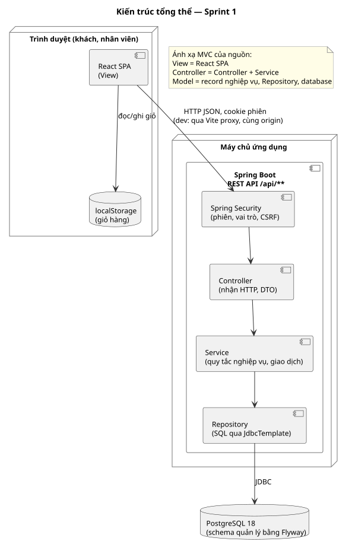
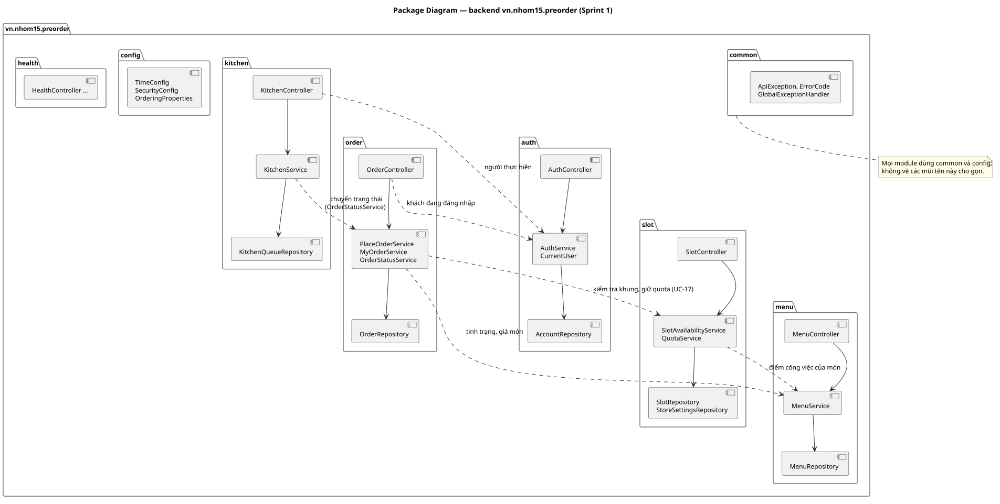

# Architecture Design
Trạng thái: Lập ở task T-08 (Sprint 1) ngày 2026-10-17 cho phạm vi Sprint 1; người dùng chưa review. Các module Sprint sau (walk-in, quầy, quản lý) được chừa chỗ trong quy tắc nhưng chưa thiết kế chi tiết.

Bước 12 của [quy trình IT3180](../../../00-References/IT3180_PROJECT_PROCESS.md): hệ thống gồm những phần nào, mỗi phần chịu trách nhiệm gì, và các phần nói chuyện với nhau ra sao.

## Input
- [Analysis Model](../Analysis-Model/README.md) (T-07): lớp Boundary/Control/Entity và sequence đặt đơn.
- [Use Cases](../../02-Requirements/Use-Cases/README.md), [SRS](../../02-Requirements/SRS/SRS.md) mục D: NFR-01 (quota đồng thời), NFR-02 (chống trùng), NFR-03 (phân quyền), NFR-05 (tách trách nhiệm), NFR-06 (mật khẩu).
- Ràng buộc kỹ thuật: Spring Boot 4.1 (Java 25), PostgreSQL 18, React 19 + Vite, đã dựng ở T-03 ([03-SourceCodes](../../../03-SourceCodes/README.md)); múi giờ cửa hàng UTC+7; ứng dụng web một cửa hàng, không tích hợp hệ thống ngoài.

## 1. Kiến trúc tổng thể
Client–server ba lớp: **React SPA** chạy trên trình duyệt, **REST API** Spring Boot, **PostgreSQL**. Frontend và backend chỉ trao đổi bằng JSON qua `/api/**`.



**Ánh xạ MVC của nguồn.** Project mẫu trong nguồn dùng MVC. Dự án giữ đúng ba trách nhiệm đó, chỉ tách View ra thành ứng dụng riêng:
| MVC | Trong dự án | Trách nhiệm |
|---|---|---|
| View | React SPA (`frontend/src/features`) | Hiển thị, nhận thao tác, gọi API. Không quyết định nghiệp vụ |
| Controller | `...Controller` (nhận HTTP) và `...Service` (điều phối use case) | Kiểm tra quyền, kiểm tra quy tắc nghiệp vụ, mở giao dịch |
| Model | Record nghiệp vụ, `...Repository`, database | Dữ liệu và cách đọc/ghi |

Ánh xạ từ mô hình phân tích: Boundary → trang React; Control → Service; Entity → bảng và record. Ví dụ `CheckoutScreen` → `CheckoutPage`, `PlaceOrderControl` → `PlaceOrderService`, `QuotaControl` → `QuotaService`, `Order` → bảng `orders` và record `Order`.

**Vì sao chọn kiểu này.** Khung đã dựng ở T-03 là SPA + REST. Tách frontend/backend thì backend là nơi duy nhất kiểm tra quyền và quy tắc (BR-33); giao diện có ẩn nút cũng không thay được kiểm tra ở backend.

## 2. Backend: module theo nghiệp vụ, tầng trong module
Mã nguồn chia theo **module nghiệp vụ** (package by feature) thay vì theo tầng (`controllers/`, `services/`…). Mở một module là thấy đủ code của một nghiệp vụ, và hai người làm hai module ít khi sửa chung file.



| Module | Trách nhiệm | Use case, quy tắc | Bảng sở hữu (T-09) |
|---|---|---|---|
| `auth` | Đăng nhập, đăng xuất, phiên; tài khoản; cung cấp người dùng hiện tại cho module khác | UC-02; BR-32, BR-33; NFR-03, NFR-06 | `user_accounts` |
| `menu` | Nhóm món, món; tình trạng bán, giá, điểm công việc | UC-03, UC-04 E1; BR-01–BR-04 | `menu_categories`, `menu_items` |
| `slot` | Giờ mở cửa, công suất bếp, khung giờ; liệt kê khung hợp lệ; **lịch bếp và giữ chỗ** (từ Sprint 4) | UC-04 bước 6, UC-17; BR-06–BR-16, BR-36, BR-39–BR-41 | `store_settings`, `time_slots` |
| `order` | Đặt đơn, đơn của khách, **mọi chuyển trạng thái đơn** | UC-04 bước 8–11, UC-05; BR-17, BR-28, BR-35, BR-37, BR-38; SRS B.5 | `orders`, `order_lines` |
| `kitchen` | Hàng chờ bếp; gọi chuyển trạng thái | UC-12; BR-21, BR-22, BR-26 | Không sở hữu bảng, chỉ đọc |
| `common` | Lỗi chung, mã lỗi, định dạng phản hồi lỗi | Mọi use case | — |
| `config` | Clock, Spring Security, thuộc tính cấu hình | — | — |
| `health` | `GET /api/health` (đã có từ T-03) | — | — |

Đã thêm ở Sprint 1–3 (cập nhật 2026-10-31 cho khớp code): `counter` (màn quầy: thanh toán, bàn giao, walk-in, hủy, no-show), `report` (theo dõi UC-16, chỉ đọc). Quản lý món nằm trong `menu`, cấu hình giờ và quota trong `slot`, tài khoản nhân viên trong `auth` (không có module `admin` riêng; đường dẫn `/api/admin/**` chỉ là nhóm quyền). Walk-in gọi `QuotaService` của `slot` như pre-order. Chuyển trạng thái đơn nằm ở hai service của `order`: `OrderStatusService` (tiến độ: bếp bắt đầu, hoàn tất; quầy bàn giao) và `OrderCancellationService` (ngoại lệ: hủy, không đến nhận, có hoàn quota).

### Tầng trong một module
| Tầng | Hậu tố | Được làm | Không được làm |
|---|---|---|---|
| Controller | `...Controller` | Nhận HTTP, kiểm tra định dạng đầu vào (`@Valid`), lấy người dùng hiện tại, gọi một service, chuyển kết quả thành DTO `...Response` | Quy tắc nghiệp vụ; gọi repository; mở giao dịch |
| Service | `...Service` | Quy tắc nghiệp vụ, thứ tự kiểm tra theo đặc tả, `@Transactional`, ném `ApiException` với mã lỗi | Biết về HTTP (status code, request) |
| Repository | `...Repository` | SQL qua `JdbcTemplate`, ánh xạ dòng sang record | Quy tắc nghiệp vụ (ngoài điều kiện SQL cần cho tính đúng, ví dụ câu cập nhật có điều kiện) |
| Record nghiệp vụ, enum | danh từ (`Order`, `OrderStatus`) | Mang dữ liệu; phép tính thuần không đụng database | Gọi service, repository |

Dùng `JdbcTemplate` như T-03, không dùng JPA: các câu SQL quan trọng (giữ quota, khóa theo khách) viết tường minh, đọc được và test được.

### Quy tắc phụ thuộc giữa module
1. Chỉ gọi **Service** của module khác; không gọi Repository hay Controller của module khác.
2. Phụ thuộc một chiều, không vòng: `kitchen → order → slot → menu`; `order → menu`; mọi module → `auth` (người dùng hiện tại), `common`, `config`.
3. **Chỉ module `order` ghi bảng `orders`, `order_lines`.** Mọi chuyển trạng thái đơn đi qua hai service của `order`: `OrderStatusService` (tiến độ) và `OrderCancellationService` (hủy, không đến nhận). Mỗi chuyển chỉ thực hiện khi trạng thái hiện tại đúng trạng thái nguồn của SRS B.5 (câu cập nhật có điều kiện hoặc khóa dòng đơn rồi kiểm tra). Module khác được đọc bằng truy vấn riêng (ví dụ `KitchenQueueRepository` chỉ `SELECT`).
4. **Chỉ module `slot` ghi `time_slots.held_points`**, qua `QuotaService`. Đây là cách đáp ứng NFR-05: quy tắc quota nằm ở một chỗ, pre-order và walk-in dùng chung.

Các quy tắc này được kiểm khi review PR. Chưa dùng công cụ tự động kiểm phụ thuộc (ví dụ ArchUnit); xét lại khi có thêm module ở Sprint sau.

## 3. Xác thực, phiên và phân quyền
| Vấn đề | Quyết định | Lý do |
|---|---|---|
| Cơ chế phiên | **Session phía server** của Spring Security; trình duyệt giữ cookie phiên `HttpOnly`, `SameSite=Lax` | Đăng xuất hủy phiên ngay, đúng UC-02 bước 8 ("không dùng lại được"). Token JWT không thu hồi được trước khi hết hạn nếu không thêm danh sách chặn. Frontend và API cùng origin (qua Vite proxy) nên cookie dùng được trực tiếp |
| Hết hạn phiên | Không hoạt động 30 phút (mặc định của server, cấu hình được) | Đủ cho một lượt đặt đơn; phiên hết hạn xử lý theo UC-02 E4 |
| Mật khẩu | Băm bằng BCrypt qua `PasswordEncoder` của Spring Security | NFR-06; không tự viết thuật toán băm |
| CSRF | Bật. Token đặt ở cookie `XSRF-TOKEN` (JavaScript đọc được), frontend gửi lại ở header `X-XSRF-TOKEN` cho mọi request thay đổi dữ liệu, kể cả đăng nhập. `CsrfCookieFilter` bảo đảm mọi phản hồi (kể cả 401 đầu tiên) kèm cookie này | Dùng cookie phiên thì phải chống CSRF. Cài ở T-12 (`SecurityConfig`, `CsrfCookieFilter`) |
| Kiểm tra vai trò | Theo đường dẫn API trong `SecurityConfig` (bảng mục 5). Đường dẫn chưa khai báo **bị từ chối mặc định** (401 nếu chưa đăng nhập, 403 nếu đã đăng nhập) | Một chỗ nhìn được toàn bộ quyền, dễ đối chiếu với UC-02 mục "Yêu cầu phân quyền chung"; thêm API mới mà quên khai báo quyền thì bị chặn thay vì bị mở |
| Kiểm tra sở hữu đơn | Trong service: truy vấn luôn kèm `customer_id` của người đang đăng nhập; không thấy thì trả 404 | UC-05 E1: không tiết lộ đơn của người khác có tồn tại hay không (NFR-03) |
| Chưa đăng nhập / sai vai trò | 401 `UNAUTHENTICATED` / 403 `FORBIDDEN` dạng JSON, không chuyển hướng | SPA tự chuyển tới trang đăng nhập (UC-02 E4) hoặc báo không có quyền (E5) |

Vai trò: `CUSTOMER`, `KITCHEN`, `COUNTER`, `MANAGER`. Quản lý làm được thao tác của quầy (SRS B.2) nên đường dẫn của quầy cho cả `COUNTER` và `MANAGER` (Sprint sau).

## 4. Các quyết định kỹ thuật khác
| Vấn đề | Quyết định | Liên quan |
|---|---|---|
| Thời gian | Mọi code nghiệp vụ lấy giờ qua bean `Clock` (múi giờ `Asia/Ho_Chi_Minh`, đã có ở T-03). "Hôm nay", "khung hợp lệ", "trễ" đều tính theo giờ cửa hàng | BR-15, BR-21, BR-26; test cố định được thời điểm |
| Cấu hình nghiệp vụ | Hai nhóm: **quản lý sửa khi vận hành** (giờ mở cửa, quota mặc định) lưu trong database, bảng `store_settings`; **cấu hình hệ thống** (độ dài khung 15, đặt trước 30 phút, cửa sổ chuẩn bị 15, N = 3 đơn) lưu trong `application.yaml` mục `app.ordering` | BR-06, BR-07, BR-15, BR-21, BR-37. Nhóm đầu có màn hình quản lý ở PB-04; nhóm sau "cấu hình được" nhưng không đổi trong vận hành |
| Giao dịch | `@Transactional` ở service. Đặt đơn là **một giao dịch** gồm giữ quota và tạo đơn | BR-10, UC-17 E3 |
| Đồng thời | Giữ chỗ bằng **khóa lịch bếp theo ngày** (`pg_advisory_xact_lock`, từ Sprint 4; trước đó là câu cập nhật có điều kiện trên dòng khung); các lần đặt của một khách xử lý lần lượt bằng **khóa dòng tài khoản** (`SELECT … FOR UPDATE`). Chi tiết ở [Class Design](../Class-Design/README.md) mục 3 | NFR-01, NFR-02, BR-17, BR-37 |
| Định dạng lỗi | Mọi lỗi trả JSON theo chuẩn Problem Details (RFC 9457, Spring có sẵn `ProblemDetail`), thêm trường `code` là mã máy đọc được (bảng mục 5.3). Frontend chọn câu thông báo tiếng Việt theo `code` | Một nơi xử lý lỗi (`GlobalExceptionHandler`); câu chữ giao diện nằm ở frontend |
| Tiền | Số nguyên đồng (VND), kiểu `int`/`integer`, không dùng số thực | Không có giảm giá, thuế (UC-04 Ghi chú) |
| Định danh đơn | `id` số tự tăng trong URL. Khách đoán id đơn người khác chỉ nhận 404 (kiểm tra sở hữu) | NFR-03 |
| Log | SLF4J như T-03; không ghi mật khẩu, không ghi toàn bộ request | NFR-06 |

## 5. REST API (Sprint 1)
Tiền tố `/api`. JSON, tên trường camelCase. Giờ có ngày dạng ISO-8601 theo giờ cửa hàng không kèm múi giờ (`2026-10-17T11:30`); thời điểm ghi nhận (ví dụ `confirmedAt`) kèm múi giờ (`2026-10-17T10:52:31+07:00`).

### 5.1. Danh sách endpoint
| Phương thức, đường dẫn | Quyền | Use case | Mô tả |
|---|---|---|---|
| `POST /api/auth/login` | Công khai | UC-02 bước 1–6 | Đăng nhập, tạo phiên |
| `POST /api/auth/logout` | Đã đăng nhập | UC-02 bước 7–8 | Hủy phiên |
| `GET /api/auth/me` | Đã đăng nhập | UC-02 | Người dùng hiện tại; frontend gọi khi tải trang để biết đã đăng nhập chưa |
| `GET /api/menu` | Công khai | UC-03 | Món đang bán theo nhóm |
| `GET /api/menu/items/{id}` | Công khai | UC-04 E1 | Tình trạng và giá hiện tại của một món, dùng khi thêm vào giỏ |
| `GET /api/slots?lines=…` | `CUSTOMER` | UC-04 bước 6 | Khung hôm nay và tình trạng theo giỏ |
| `POST /api/orders` | `CUSTOMER` | UC-04 bước 7–11 | Đặt đơn |
| `GET /api/orders` | `CUSTOMER` | UC-05 bước 1–2 | Đơn của khách đang đăng nhập |
| `GET /api/orders/{id}` | `CUSTOMER` | UC-05 bước 3–4, UC-04 bước 11 | Chi tiết một đơn của mình |
| `GET /api/kitchen/queue` | `KITCHEN` | UC-12.1 | Hàng chờ bếp ba nhóm |
| `POST /api/kitchen/orders/{id}/start` | `KITCHEN` | UC-12.2 bước 4–5 | `CONFIRMED → PREPARING` |
| `POST /api/kitchen/orders/{id}/complete` | `KITCHEN` | UC-12.2 bước 6–7 | `PREPARING → READY` |
| `GET /api/counter/orders` | `COUNTER`, `MANAGER` | UC-08 bước 2 | Đơn hôm nay đang xử lý, kèm số tiền cần thu |
| `POST /api/counter/orders/{id}/payment` | `COUNTER`, `MANAGER` | UC-08 bước 3–4 | Ghi nhận `UNPAID → PAID` kèm phương thức |
| `POST /api/counter/orders/{id}/handover` | `COUNTER`, `MANAGER` | UC-09 bước 4–5 | `READY → PICKED_UP` khi đúng mã và đã `PAID` |
| `POST /api/counter/walk-in/estimate` | `COUNTER`, `MANAGER` | UC-07 bước 2–3 | Khung dự kiến sớm nhất (BR-18) và số tiền cần thu; chưa giữ quota |
| `POST /api/counter/walk-in` | `COUNTER`, `MANAGER` | UC-07 bước 5–7 | Xác nhận đơn walk-in đã thu tiền; 201 mới, 200 khi gửi lại cùng `requestId` |
| `POST /api/auth/register` | Công khai | UC-01 | Đăng ký khách, đăng nhập luôn; 201 + `CurrentUser` |
| `GET /api/admin/menu` | `MANAGER` | UC-13 | Mọi món kể cả ngừng bán, có `workloadPoints`; danh sách nhóm |
| `POST /api/admin/menu/items`, `PUT /api/admin/menu/items/{id}` | `MANAGER` | UC-13.1, 13.2 | Thêm, sửa món |
| `POST /api/admin/menu/items/{id}/availability`, `/discontinue`, `/restore` | `MANAGER` | UC-13.3, 13.4 | Còn bán/tạm hết; ngừng bán; bán lại |
| `GET /api/admin/slots/today`, `PUT /api/admin/settings`, `PUT /api/admin/slots/today/{HH:mm}/quota` | `MANAGER` | UC-14 | Khung hôm nay có quota và điểm đã giữ; đổi giờ, quota mặc định; quota riêng (`null` = về mặc định) |
| `POST /api/orders/{id}/cancel` | `CUSTOMER` | UC-06 | Khách hủy đơn `CONFIRMED` trước cửa sổ chuẩn bị; hoàn đủ điểm |
| `POST /api/counter/orders/{id}/cancel` | `COUNTER` (chỉ walk-in `CONFIRMED`), `MANAGER` | UC-11 | Hủy kèm `reason` bắt buộc; hoàn điểm nếu từ `CONFIRMED` |
| `POST /api/counter/orders/{id}/no-show` | `COUNTER`, `MANAGER` | UC-10 | `READY → NO_SHOW` khi quá hạn (BR-25); không hoàn |
| `GET /api/admin/staff`, `POST /api/admin/staff`, `POST /api/admin/staff/{id}/lock`, `/unlock` | `MANAGER` | UC-15 | Tài khoản quầy/bếp: xem, tạo, khóa, mở khóa |
| `GET /api/admin/dashboard` | `MANAGER` | UC-16 | Khung hôm nay, đơn đang xử lý có cờ trễ, thống kê ngày |
| `GET /api/health` | Công khai | — | Có từ T-03 |

### 5.2. Dữ liệu vào/ra chính
**`POST /api/auth/login`**
```json
{ "loginId": "khach1@example.com", "password": "..." }
```
200 → `CurrentUser`: `{ "id": 3, "displayName": "Khách Một", "role": "CUSTOMER" }`. `GET /api/auth/me` trả cùng kiểu.

**`GET /api/menu`** → 200
```json
{ "categories": [ { "id": 1, "name": "Burger", "items": [
  { "id": 12, "name": "Burger bò", "description": null, "imageUrl": null, "price": 45000, "available": true } ] } ] }
```
Chỉ có món đang bán; `available = false` là tạm hết. Không trả điểm công việc (UC-03 Ghi chú). `GET /api/menu/items/{id}` trả một phần tử `item` như trên; món không tồn tại hoặc ngừng bán → 404 `MENU_ITEM_NOT_FOUND`.

**`GET /api/slots?lines=12:2,15:1`** (mã món:số lượng, ngăn bằng dấu phẩy) → 200
```json
{ "date": "2026-10-17",
  "slots": [ { "start": "2026-10-17T11:30", "end": "2026-10-17T11:45", "bookable": true } ],
  "unavailableReason": null }
```
`unavailableReason` khi không chọn được khung nào: `NO_SLOT_LEFT_TODAY` (E2), `ALL_SLOTS_FULL` (E3), `ORDER_TOO_LARGE` (E4). Không trả quota hay điểm (BR-36).

**`POST /api/orders`**
```json
{ "requestId": "8a0f3c2e-5b1d-4c47-9a0e-2f6d1c3b7e91",
  "slotStart": "2026-10-17T11:30",
  "lines": [ { "menuItemId": 12, "quantity": 2, "unitPrice": 45000 } ] }
```
`requestId` là UUID frontend tạo khi khách vào bước 7, giữ nguyên khi gửi lại (A1). `unitPrice` là giá khách đã thấy trong giỏ, để backend so ở bước 8c. Mỗi món một dòng; `quantity` từ 1 đến 999 (giới hạn trên chỉ để tránh tràn số, không phải quy tắc nghiệp vụ). `GET /api/slots` chỉ nhận `lines` đúng dạng `mã:số lượng` ngăn bằng dấu phẩy; sai dạng, giỏ trống hoặc món không tồn tại → 400 `VALIDATION_ERROR`.
- 201 + `OrderDetail` (header `Location: /api/orders/{id}`): đơn mới.
- 200 + `OrderDetail`: mã yêu cầu đã có đơn (A1), trả đúng đơn đó.

`OrderDetail` (cũng là kết quả `GET /api/orders/{id}`):
```json
{ "id": 41, "pickupCode": "K7M3QX", "slotStart": "2026-10-17T11:30", "slotEnd": "2026-10-17T11:45",
  "status": "CONFIRMED", "paymentStatus": "UNPAID", "paymentMethod": null,
  "totalAmount": 90000, "confirmedAt": "2026-10-17T10:52:31+07:00",
  "lines": [ { "menuItemId": 12, "name": "Burger bò", "quantity": 2, "unitPrice": 45000, "lineTotal": 90000 } ] }
```
`GET /api/orders` trả `{ "orders": [OrderSummary] }`, mỗi phần tử gồm `id`, `pickupCode`, `slotStart`, `slotEnd`, `status`, `paymentStatus`, `totalAmount`, sắp theo UC-05 bước 2.

**`GET /api/kitchen/queue`** → 200
```json
{ "serverTime": "2026-10-17T11:20:05+07:00",
  "preparing": [KitchenOrder], "dueSoon": [KitchenOrder], "upcoming": [KitchenOrder] }
```
`KitchenOrder`: `id`, `pickupCode`, `slotStart`, `slotEnd`, `source` (`PRE_ORDER`/`WALK_IN`), `confirmedAt`, `late` (BR-26), `lines` gồm `name`, `quantity`. Không có giá và thanh toán (UC-12 Ghi chú). `start`/`complete` trả 200 `{ "id": 41, "status": "PREPARING" }`.

**`GET /api/counter/orders`** → 200 `{ "orders": [CounterOrder] }`. `CounterOrder`: `id`, `pickupCode`, `customerName` (null với walk-in), `slotStart`, `slotEnd`, `source`, `status`, `paymentStatus`, `paymentMethod`, `totalAmount`, `lines` gồm `name`, `quantity`. Chỉ đơn hôm nay ở `CONFIRMED`, `PREPARING`, `READY`.

**`POST /api/counter/orders/{id}/payment`** với `{ "method": "CASH" }` hoặc `"BANK_TRANSFER"` → 200 `{ "id": 41, "paymentStatus": "PAID", "paymentMethod": "CASH" }`. Thiếu hoặc sai `method` → 400; đơn không có → 404; đã ghi nhận → 409 `ALREADY_PAID`; đơn đã bàn giao, hủy, vắng mặt → 409 `ORDER_NOT_PAYABLE`.

**`POST /api/counter/orders/{id}/handover`** với `{ "pickupCode": "K7M3QX" }` → 200 `{ "id": 41, "status": "PICKED_UP" }`. Mã so không phân biệt chữ hoa thường. Thiếu hoặc trống mã → 400; không có đơn → 404; đơn không ở `READY` (kể cả đã bàn giao) → 409 `INVALID_STATUS_TRANSITION` kèm `currentStatus`; sai mã → 409 `PICKUP_CODE_MISMATCH`; chưa thanh toán → 409 `ORDER_NOT_PAID`. Thứ tự kiểm tra: tồn tại, `READY`, mã, thanh toán.

**Sprint 2.** `SLOT_FULL` của `POST /api/orders` kèm `alternatives`: tối đa 3 `SlotView` gợi ý (UC-18, BR-16). `SLOT_FULL` của `POST /api/counter/walk-in` kèm `nextSlot` (khung mới để báo lại khách, BR-19) nếu còn. `POST /api/counter/walk-in` nhận `{ requestId, slotStart, lines: [{menuItemId, quantity, unitPrice}], paymentMethod }`; ước tính nhận `{ lines }` cùng dạng dòng, trả `{ slot: {start, end}, totalAmount }`. Giữ quota (`QuotaService`) khóa chia sẻ dòng `store_settings`, đổi cấu hình khóa ghi, để BR-11 không bị chen ngang.

**Sprint 3.** `OrderDetail` có thêm `cancelReason` (null nếu chưa hủy hoặc khách tự hủy). `CounterOrder` có thêm `overdue` (đơn `READY` đã qua giờ kết thúc khung + `app.ordering.no-show-grace-minutes`, mặc định 30). Hủy và no-show nằm ở `OrderCancellationService` (module `order`): khóa dòng đơn `FOR UPDATE`, kiểm tra quy tắc, đổi trạng thái, gọi `QuotaService.release` trong cùng giao dịch; `release` trừ `held_points` bằng câu `UPDATE … WHERE held_points >= ?`, không đủ thì ném lỗi để giao dịch hủy. Tài khoản nhân viên ở `StaffAccountService` (module `auth`, dùng lại kiểm tra định danh của đăng ký). Bảng theo dõi ở module mới `report`, chỉ đọc. `StaffAccount`: `id`, `loginId`, `displayName`, `role`, `locked`. `Dashboard`: `date`, `slots` (như `AdminSlot`), `activeOrders` (`id`, `pickupCode`, `slotStart`, `status`, `source`, `late`), `stats` (`preOrders`, `walkIns`, `pickedUp`, `cancelled`, `noShow`, `lateNow`, `heldPoints`, `quotaPoints`, `quotaUsagePercent`).

**Sửa sau review (2026-10-31).** `CounterOrder` có thêm `stale` (đơn chưa kết thúc của ngày đã qua; `GET /api/counter/orders` trả cả các đơn này, đứng đầu). `KitchenOrder` có thêm `prepareFrom` (thời điểm đơn vào nhóm cần chuẩn bị; bếp vẫn làm trước được). `OrderDetail` có thêm `cancelDeadline` (hạn khách tự hủy). `Dashboard.stats` có thêm `staleOpen`. `CANCEL_NOT_ALLOWED` kèm `reason` = `PAID` hoặc `PREPARATION_WINDOW`. Bộ lọc `LockedAccountFilter` (sau `SecurityContextHolderFilter`) hỏi `AuthService.isBlocked` ở mỗi yêu cầu đã đăng nhập; tài khoản bị khóa thì hủy phiên, trả 401 `UNAUTHENTICATED`. Kiểm tra khung hợp lệ (`checkBookable`, `checkWalkInSlot`) lấy khóa chia sẻ `store_settings` **trước** khi đọc giờ mở cửa, nên đổi giờ cùng lúc không lọt đơn ngoài giờ (BR-11).

**Sprint 4 — lịch bếp (2026-10-31, PB-22).** Thêm vào module `slot`:
- `KitchenPlanner`: hàm thuần (không đọc database) xếp các đơn vào khoảng làm 15 phút theo hạn sớm làm trước, làm sớm nhất có thể; trả lịch có kịp hay không, điểm dự kiến làm mỗi khoảng và khoảng bắt đầu của từng đơn. Test riêng bằng `KitchenPlannerTest`.
- `KitchenPlanService`: dựng ảnh chụp lịch hôm nay (`Snapshot`) từ cấu hình, công suất riêng và các đơn `CONFIRMED`/`PREPARING`; dùng chung cho đặt đơn, walk-in, danh sách khung, màn quản lý và hàng chờ bếp.
- `QuotaService.reserve(date, start, lines, walkIn)`: khóa chia sẻ `store_settings` → khóa lịch bếp của ngày → kiểm tra giới hạn quầy → đơn quá lớn → bếp còn kịp (Class Design mục 3).

API: `AdminDay` thêm `holdMinutes`, `preOrderSharePercent`, `pickupLimitOrders`; `AdminSlot` thêm `plannedPoints` (điểm bếp dự kiến làm trong khoảng) và `pickupOrders` (số đơn nhận trong khung); `quota` nay là công suất bếp của khoảng làm. `PUT /api/admin/settings` nhận thêm ba trường trên (không gửi thì giữ giá trị cũ). `KitchenOrder.prepareFrom` = giờ bắt đầu theo lịch bếp nếu sớm hơn mốc 15 phút trước khung. `Dashboard.stats.quotaUsagePercent` tính theo điểm dự kiến làm.
