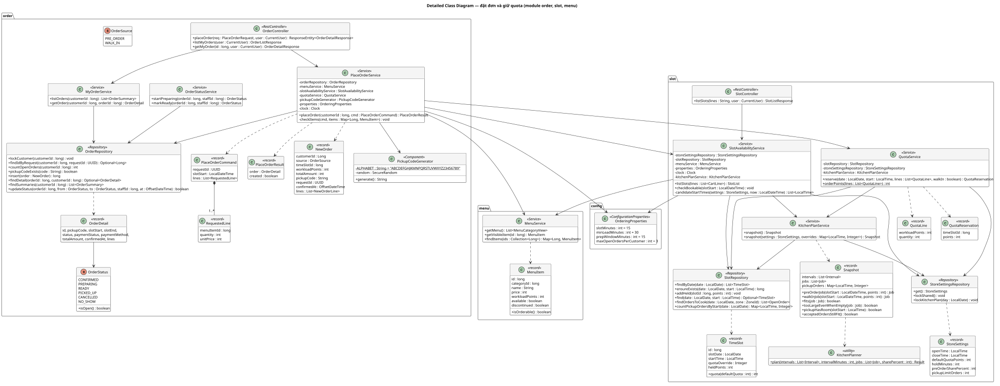
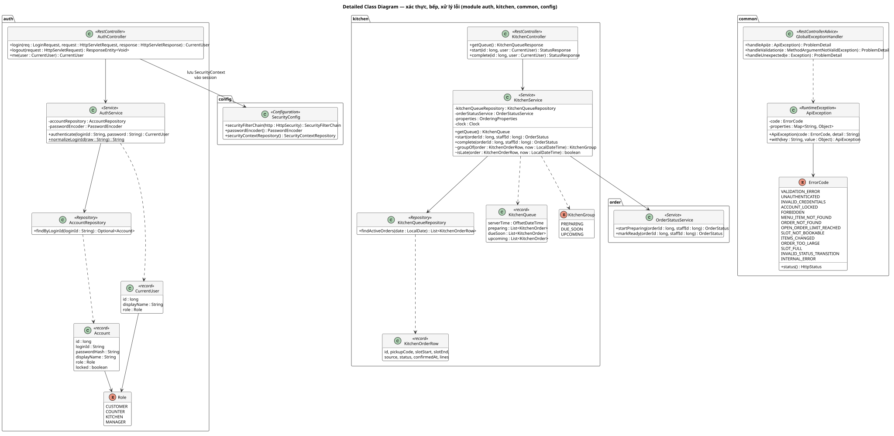

# Detailed Class Design
Trạng thái: Lập ở task T-10 (Sprint 1) ngày 2026-10-17 cho backend phần Sprint 1; người dùng chưa review. Tên class, method là thiết kế để code theo; khi code thấy cần đổi (thêm tham số, tách method) thì sửa tài liệu này trong cùng PR.

Bước 13.2 của [quy trình IT3180](../../../00-References/IT3180_PROJECT_PROCESS.md): xác định class, thuộc tính, method, quan hệ và trách nhiệm ở mức lập trình viên bắt đầu code được.

## Input
- [Analysis Model](../Analysis-Model/README.md): trách nhiệm từng Control, sequence đặt đơn.
- [Architecture](../Architecture/ARCHITECTURE.md): module, tầng, quy tắc phụ thuộc, REST API, mã lỗi.
- [Database Design](../Database/DATABASE_DESIGN.md): bảng, ràng buộc, bất biến.

## 1. Sơ đồ lớp
Ký hiệu: `+` public, `-` private, `~` dùng trong package (để test), gạch chân là `static`. `<<record>>` là Java record (dữ liệu bất biến), `<<Service>>`… là annotation Spring tương ứng. Không vẽ DTO `...Request`/`...Response` của controller: chúng là record khớp đúng JSON ở Architecture mục 5.2.

### 1.1. Đặt đơn và giữ quota (`order`, `slot`, `menu`)


### 1.2. Xác thực, bếp, xử lý lỗi (`auth`, `kitchen`, `common`, `config`)


## 2. Trách nhiệm từng class
| Class | Trách nhiệm | Từ phân tích | Quy tắc | Task |
|---|---|---|---|---|
| `AuthController` | `POST /api/auth/login`, `logout`, `GET /api/auth/me`; lưu `SecurityContext` vào session sau khi `AuthService` xác thực | `LoginScreen` → `AuthControl` | UC-02 | T-12 |
| `AuthService` | Chuẩn hóa định danh, tìm tài khoản, so mật khẩu, **rồi mới** kiểm tra khóa (mục 4.1) | `AuthControl` | BR-32, NFR-06 | T-12 |
| `SecurityConfig` | Quy tắc quyền theo đường dẫn, CSRF, trả 401/403 JSON, `PasswordEncoder` BCrypt | `AuthControl` | BR-33, NFR-03 | T-12 |
| `MenuService` | Menu theo nhóm (bỏ món ngừng bán); một món đang hiển thị (`getVisibleItem`); tải nhiều món theo id | `MenuControl` | BR-03, BR-04 | T-15 |
| `SlotAvailabilityService` | Liệt kê khung hôm nay kèm tình trạng theo giỏ (mục 4.2); kiểm tra một khung còn đặt được | `SlotAvailabilityControl` | BR-06, BR-15, BR-36 | T-18 |
| `QuotaService` | Tính điểm đơn; giữ quota cho khung bằng câu cập nhật có điều kiện (mục 3) | `QuotaControl` | BR-07–BR-13, NFR-01 | T-16 |
| `PlaceOrderService` | Giao dịch đặt đơn theo đúng thứ tự kiểm tra (mục 3) | `PlaceOrderControl` | BR-10, BR-17, BR-35, BR-37, BR-38 | T-18 |
| `PickupCodeGenerator` | Sinh mã 6 ký tự từ 31 ký tự cho phép, dùng `SecureRandom` | `PlaceOrderControl` | BR-38 | T-18 |
| `MyOrderService` | Danh sách, chi tiết đơn **của khách đang đăng nhập** | `MyOrdersControl` | BR-33, UC-05 E1 | T-20 |
| `OrderStatusService` | Nơi duy nhất đổi `orders.status`; chỉ chuyển khi trạng thái hiện tại đúng | `OrderProgressControl` | SRS B.5 | T-22 |
| `KitchenService` | Hàng chờ ba nhóm, sắp xếp, đánh dấu trễ (mục 4.3); gọi `OrderStatusService` | `KitchenQueueControl`, `OrderProgressControl` | BR-21, BR-22, BR-26 | T-21, T-22 |
| `...Repository` | SQL qua `JdbcTemplate` cho bảng của module mình (Architecture mục 2) | Entity | — | theo module |
| `ApiException`, `ErrorCode` | Lỗi nghiệp vụ có mã; `ErrorCode` biết HTTP status | — | Architecture mục 5.3 | T-12 |
| `GlobalExceptionHandler` | Chuyển mọi exception thành Problem Details; lỗi không lường trước → 500 `INTERNAL_ERROR`, ghi log | — | UC-04 E10 | T-12 |
| `OrderingProperties` | Đọc `app.ordering.*`: độ dài khung, đặt trước tối thiểu, cửa sổ chuẩn bị, số đơn tối đa | — | BR-06, BR-15, BR-21, BR-37 | T-16 |

`OrderStatus.isOpen()` trả `true` với `CONFIRMED`, `PREPARING`, `READY`: "đơn chưa kết thúc" của BR-37 và UC-05 bước 2.

## 3. Giao dịch đặt đơn và giữ quota
`PlaceOrderService.placeOrder` có `@Transactional`: mọi bước dưới đây chung một giao dịch PostgreSQL (mức cô lập mặc định READ COMMITTED). `ApiException` là `RuntimeException`, nên mọi lỗi đều làm Spring hủy giao dịch: quota đã giữ và đơn đã chèn cùng biến mất (BR-10, E10).

| # | Bước | SQL / thao tác | Lỗi | Đặc tả |
|---|---|---|---|---|
| 1 | Khóa tài khoản khách | `SELECT id FROM user_accounts WHERE id = ? FOR UPDATE` | — | Xử lý lần lượt theo khách |
| 2 | Đã có đơn cho mã yêu cầu? | `SELECT id FROM orders WHERE customer_id = ? AND request_id = ?` → có thì trả đơn đó, `created = false` | — | A1, BR-17 |
| 3 | Đếm đơn chưa kết thúc | `SELECT count(*) FROM orders WHERE customer_id = ? AND status IN ('CONFIRMED','PREPARING','READY')` | ≥ N → `OPEN_ORDER_LIMIT_REACHED` | E5, BR-37 |
| 4 | Khung còn đặt được | `SlotAvailabilityService.checkBookable(slotStart)` (mục 4.2) | `SLOT_NOT_BOOKABLE` | E6, BR-15 |
| 5 | Món và giá | `MenuService.findItems(ids)`; mỗi dòng: món tồn tại, `isOrderable()`, `price == unitPrice` | `ITEMS_CHANGED` kèm danh sách | E7, BR-04, BR-35 |
| 6 | Giữ quota | `QuotaService.reserve(...)`, xem bên dưới | `ORDER_TOO_LARGE`, `SLOT_FULL` | E8, E9, UC-17 |
| 7 | Sinh mã nhận | `generate()` lặp tới khi `pickupCodeExists` trả `false` | — | BR-38 |
| 8 | Chèn đơn và dòng đơn | `INSERT INTO orders … RETURNING id`; `INSERT INTO order_lines …` (batch) | — | Bước 10, BR-28, BR-35, BR-08 |
| 9 | Trả kết quả | Đọc lại `OrderDetail`, `created = true` → controller trả 201 | — | Bước 11 |

**`QuotaService.reserve(date, start, lines)`** (UC-17):
1. `points = orderPoints(lines)` = Σ điểm × số lượng (BR-08).
2. Bảo đảm khung có dòng: `INSERT INTO time_slots (slot_date, start_time) VALUES (?, ?) ON CONFLICT (slot_date, start_time) DO NOTHING`.
3. Nếu `points = 0`: lấy `id` của khung, trả `QuotaReservation(id, 0)` (BR-13).
4. Ngược lại, kiểm tra và giữ trong **một câu lệnh**:
   ```sql
   UPDATE time_slots
   SET held_points = held_points + :points
   WHERE slot_date = :date AND start_time = :start
     AND held_points + :points <= COALESCE(quota_override, :defaultQuota)
   RETURNING id
   ```
5. Không có dòng trả về: đọc quota của khung; `points > quota` → `ORDER_TOO_LARGE` (UC-17 E1), ngược lại `SLOT_FULL` (UC-17 E2).

**Vì sao câu lệnh ở bước 4 không bị chen ngang (NFR-01).** `UPDATE` khóa dòng khung trước khi ghi. Giao dịch thứ hai cập nhật cùng khung phải chờ giao dịch đầu kết thúc; khi được chạy tiếp, PostgreSQL **kiểm tra lại điều kiện `WHERE` trên giá trị mới nhất** của dòng. Ví dụ: khung quota 10, hai khách cùng đặt 8 điểm. Người đầu cộng lên 8 và giữ khóa; người sau chờ, rồi thấy `8 + 8 > 10`, không cập nhật dòng nào và nhận `SLOT_FULL`. Không cần đọc trước rồi mới ghi, nên không có khoảng hở giữa "kiểm tra" và "giữ".

**Vì sao khóa tài khoản ở bước 1.** Hai lần gửi đồng thời của **cùng một khách** đều có thể đi qua bước 2 và 3 trước khi lần nào kịp chèn đơn: cả hai thấy "chưa có đơn" (vi phạm BR-17) hoặc "mới 2 đơn" (vi phạm BR-37). Khóa dòng tài khoản buộc lần thứ hai chờ lần thứ nhất xong rồi mới đọc, nên lần thứ hai thấy đơn vừa tạo. Ràng buộc `uq_orders_customer_id_request_id` vẫn giữ lại như lớp phòng vệ cuối. Khóa chỉ chặn các lần đặt của cùng khách, khách khác không bị ảnh hưởng.

**Không có deadlock.** Mọi giao dịch đặt đơn khóa theo cùng thứ tự: dòng tài khoản rồi dòng khung. Bếp chỉ khóa dòng đơn. Walk-in (Sprint sau) chỉ khóa dòng khung.

**Mã nhận trùng khi đồng thời.** Hai giao dịch có thể cùng sinh một mã chưa tồn tại, giao dịch sau vi phạm `UNIQUE` và bị hủy (lỗi 500). Xác suất cực nhỏ (31⁶ mã); khách gửi lại an toàn nhờ A1 vì giao dịch lỗi không để lại đơn nào. Chấp nhận, không thêm cơ chế thử lại.

**Kiểm chứng bắt buộc** (T-16, T-18): test chạy với PostgreSQL thật, không dùng mock cho repository:
- nhiều luồng cùng giữ quota một khung → tổng `held_points` ≤ quota, số đơn thành công đúng bằng số đơn vừa đủ (NFR-01, bản rút gọn; bản 50 request đầy đủ ở Sprint 2);
- cùng mã yêu cầu gửi đồng thời → đúng một đơn (NFR-02);
- `held_points` bằng tổng điểm các đơn của khung sau mỗi test (Database Design mục 3).

## 4. Thuật toán khác
### 4.1. Đăng nhập (`AuthService.authenticate`)
1. `normalizeLoginId`: bỏ khoảng trắng đầu cuối; có `@` thì là email, chuyển chữ thường; ngược lại là số điện thoại, bỏ mọi khoảng trắng.
2. Không có tài khoản → vẫn gọi `passwordEncoder.matches` với một chuỗi băm giả rồi báo `INVALID_CREDENTIALS`. So mật khẩu cả khi không có tài khoản để thời gian phản hồi không lộ định danh nào tồn tại.
3. Mật khẩu sai → `INVALID_CREDENTIALS` (UC-02 E1).
4. Mật khẩu đúng nhưng `locked` → `ACCOUNT_LOCKED` (E2).
5. Trả `CurrentUser`; `AuthController` tạo session mới (đổi id phiên khi đăng nhập), lưu `SecurityContext` chứa `CurrentUser` và vai trò.

Tự viết bước 2–4 thay vì để `DaoAuthenticationProvider` của Spring Security làm hết. Lý do: provider có sẵn kiểm tra khóa **trước** khi so mật khẩu, nên người không biết mật khẩu vẫn biết được tài khoản bị khóa, ngược thứ tự của UC-02.

### 4.2. Khung giờ (`SlotAvailabilityService`)
Đặt `now = LocalDateTime.now(clock)`, `today = now.toLocalDate()`, độ dài khung `L = slotMinutes`, đặt trước tối thiểu `lead = minLeadMinutes`.

`candidateStartTimes`: các `t` từ `openTime`, bước `L`, với `t + L ≤ closeTime` và `today.atTime(t) ≥ now + lead`.

`listSlots(lines)`:
1. Danh sách ứng viên rỗng → `unavailableReason = NO_SLOT_LEFT_TODAY` (E2).
2. `points` = Σ điểm × số lượng của các món trong giỏ; món không tồn tại hoặc số lượng < 1 → `VALIDATION_ERROR`. Món tạm hết vẫn tính điểm: lỗi món chỉ báo khi gửi (E7).
3. Tải `time_slots` của `today`; khung không có dòng thì `held = 0`, quota = mặc định.
4. Mỗi khung: `bookable = points ≤ quota − held` (đúng cả khi `points = 0`).
5. Không khung nào `bookable`: nếu `points > quota` ở **mọi** khung → `ORDER_TOO_LARGE` (E4), ngược lại `ALL_SLOTS_FULL` (E3).

`checkBookable(slotStart)`: `slotStart.toLocalDate() == today`, phút chia hết cho `L`, giây bằng 0, và giờ thuộc `candidateStartTimes`. Sai bất kỳ điều kiện nào → `SLOT_NOT_BOOKABLE`.

### 4.3. Hàng chờ bếp (`KitchenService`)
`findActiveOrders(today)`: đơn `CONFIRMED`/`PREPARING` có khung thuộc hôm nay, kèm dòng đơn, sắp theo `start_time`, `confirmed_at` (BR-22).

Với `N = prepWindowMinutes`, `slotStart` là ngày + giờ bắt đầu khung:
| Điều kiện | Nhóm |
|---|---|
| `status = PREPARING` | `PREPARING` (Đang làm) |
| `CONFIRMED` và `now ≥ slotStart − N` | `DUE_SOON` (Cần chuẩn bị, BR-21) |
| `CONFIRMED` còn lại | `UPCOMING` (Sắp tới) |

`late = now ≥ slotStart` (BR-26). Thứ tự trong nhóm giữ nguyên thứ tự truy vấn. `groupOf` và `isLate` để mức package để unit test với `Clock` cố định.

### 4.4. Chuyển trạng thái (`OrderStatusService`)
```sql
UPDATE orders SET status = 'PREPARING', preparing_at = :now, preparing_by = :staffId
WHERE id = :id AND status = 'CONFIRMED'
```
Một dòng đổi → thành công. Không dòng nào → đọc trạng thái hiện tại: không có đơn → `ORDER_NOT_FOUND`; có → `INVALID_STATUS_TRANSITION` kèm `currentStatus` (UC-12 E1). Hai bếp cùng bấm: câu lệnh thứ hai chờ câu thứ nhất, rồi kiểm tra lại `status = 'CONFIRMED'` trên giá trị mới, không đổi dòng nào. `markReady` tương tự với `PREPARING → READY`, `ready_at`, `ready_by`.

## 5. Kiểm thử theo class
| Class | Loại test | Nội dung chính |
|---|---|---|
| `AuthService` | Unit (Mockito) | Thứ tự E1/E2, chuẩn hóa định danh |
| `SecurityConfig` + controller | `@WebMvcTest` / tích hợp | 401, 403 cho từng nhóm đường dẫn (T-14, NFR-03) |
| `SlotAvailabilityService` | Unit, `Clock` cố định | Biên 30 phút, giờ đóng cửa, E2/E3/E4, điểm 0 |
| `QuotaService`, `PlaceOrderService` | Tích hợp với PostgreSQL | Mục 3: đồng thời, A1, E5–E10, hủy giao dịch |
| `KitchenService` | Unit, `Clock` cố định | Biên cửa sổ chuẩn bị 15 phút, trễ |
| `OrderStatusService` | Tích hợp | Chuyển hợp lệ, chuyển sai, hai bếp cùng bấm |
| `PickupCodeGenerator` | Unit | Độ dài, chỉ ký tự cho phép |

Test tích hợp cần PostgreSQL. Cách chạy (Testcontainers hay database của Docker Compose) chốt ở T-16 cùng cấu hình test.

## Công cụ
PlantUML, kiểu chung ở `../_style.iuml`; cách render như [Analysis Model](../Analysis-Model/README.md) mục Công cụ, đổi thư mục làm việc thành `Class-Design`.

## Output chuyển giao
- T-12 → T-22: tạo class đúng tên, package và trách nhiệm ở mục 1–2. Thứ tự kiểm tra ở mục 3 là thứ tự code trong `PlaceOrderService`.
- T-16, T-18: kiểm chứng bắt buộc ở mục 3.
- T-24: các nhánh của mục 3 và 4.2 là đường đi cho Control Flow Graph.
