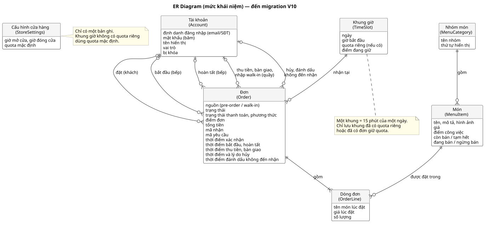
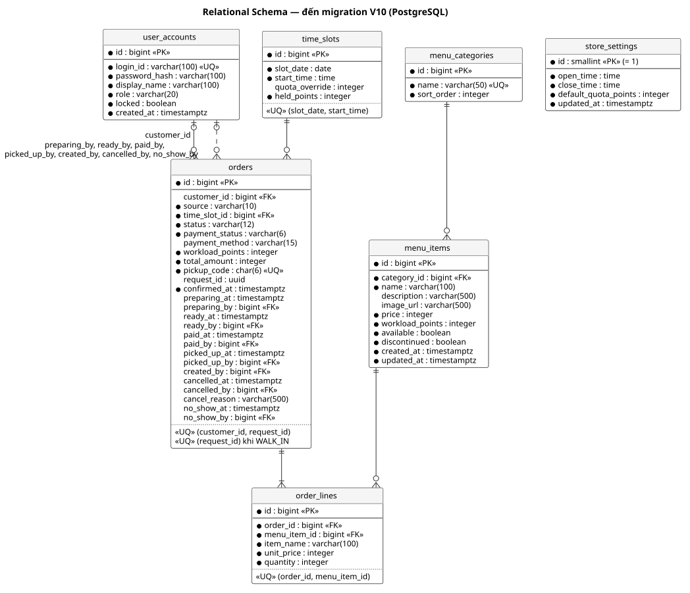

# Database Design
Trạng thái: Lập ở task T-09 (Sprint 1) ngày 2026-10-17 cho các bảng Sprint 1: tài khoản, món, cấu hình giờ mở cửa/quota, khung, đơn, dòng đơn; người dùng chưa review. Cập nhật ngày 2026-10-28 (chuẩn bị phát hành) cho khớp database thật đến migration V11: các cột thanh toán, bàn giao, walk-in, hủy, no-show của `orders` (mục 2) đã đối chiếu với schema đang chạy trong Docker.

Bước 13.1 của [quy trình IT3180](../../../00-References/IT3180_PROJECT_PROCESS.md): từ mô hình khái niệm (thực thể, thuộc tính, quan hệ) sang mô hình logic (bảng, khóa chính, khóa ngoại).

## Input
- [Analysis Model](../Analysis-Model/README.md) mục 2: các Entity.
- [Architecture](../Architecture/ARCHITECTURE.md) mục 2: module nào sở hữu bảng nào; mục 4: tiền là số nguyên, thời gian theo giờ cửa hàng.
- [SRS](../../02-Requirements/SRS/SRS.md) B.4 (BR-01–BR-38), B.5 (trạng thái đơn); đặc tả UC-02, 03, 04, 05, 12, 17.

## 1. Conceptual Model / ER Diagram

| Quan hệ | Bản số | Ý nghĩa |
|---|---|---|
| Nhóm món – Món | 1 – 0..* | Mỗi món thuộc đúng một nhóm (BR-01) |
| Tài khoản – Đơn (đặt) | 0..1 – 0..* | Đơn pre-order có đúng một khách; đơn walk-in không có (BR-20) |
| Khung giờ – Đơn | 1 – 0..* | Mỗi đơn nằm gọn trong một khung (BR-12) |
| Đơn – Món qua Dòng đơn | * – * | Một đơn có nhiều món, một món nằm trong nhiều đơn; Dòng đơn là thực thể kết hợp, mang số lượng và giá lúc đặt |
| Tài khoản – Đơn (bắt đầu, hoàn tất) | 0..1 – 0..* | Nhân viên bếp thực hiện chuyển trạng thái (UC-12 bước 5, 7) |

Các lựa chọn mô hình:
- **Khung giờ là thực thể, không chỉ là một thuộc tính giờ của đơn.** Khung có dữ liệu riêng: quota riêng do quản lý sửa (BR-07) và điểm đang giữ. Đơn trỏ tới khung, nên "các đơn của khung" và "quota của khung" nằm cùng một chỗ.
- **Chỉ lưu khung khi cần.** Dòng khung được tạo lần đầu khi có đơn giữ quota hoặc khi quản lý sửa quota riêng. Khung chưa có dòng thì quota là quota mặc định, điểm đang giữ là 0. Không phải sinh trước hàng chục khung mỗi ngày, và đổi giờ mở cửa không phải sửa dữ liệu khung.
- **Điểm đang giữ lưu thành cột `held_points`**, thay vì mỗi lần tính tổng điểm các đơn của khung. Lý do: giữ quota cần một chỗ để khóa và cập nhật có điều kiện trong một câu lệnh (NFR-01, xem mục 3). Cái giá là phải giữ cột này khớp với tổng điểm đơn; chỉ `QuotaService` được ghi cột này (Architecture mục 2).
- **Dòng đơn chụp lại tên và giá món** lúc xác nhận (BR-35). Quản lý đổi giá hay tên món sau đó không làm đổi đơn cũ.
- **Đơn lưu điểm đơn** lúc xác nhận (BR-08). Không cần lưu điểm từng dòng vì không có nghiệp vụ nào dùng tới.

## 2. Logical Model / Relational Schema

Quy ước: tên bảng snake_case số nhiều, khóa chính `id` kiểu `bigint GENERATED ALWAYS AS IDENTITY` (trừ `store_settings`), thời điểm kiểu `timestamptz`, tiền và điểm kiểu `integer`. Giá trị liệt kê (vai trò, trạng thái…) lưu `varchar` kèm `CHECK`, khớp tên enum trong Java, thay vì kiểu enum của PostgreSQL: thêm giá trị ở Sprint sau chỉ cần sửa `CHECK`. Tên ràng buộc theo [CODING_CONVENTION](../../../03-SourceCodes/CODING_CONVENTION.md) mục Database.

### `user_accounts` (module `auth`)
| Cột | Kiểu | Ràng buộc | Ý nghĩa, quy tắc |
|---|---|---|---|
| `id` | bigint | PK | |
| `login_id` | varchar(100) | NOT NULL, UNIQUE | Email (chữ thường) hoặc số điện thoại (bỏ khoảng trắng), đã chuẩn hóa như UC-02 bước 3 (BR-31, BR-32) |
| `password_hash` | varchar(100) | NOT NULL | Chuỗi BCrypt, không bao giờ là mật khẩu gốc (NFR-06) |
| `display_name` | varchar(100) | NOT NULL | Tên hiển thị |
| `role` | varchar(20) | NOT NULL, CHECK ∈ {`CUSTOMER`, `COUNTER`, `KITCHEN`, `MANAGER`} | Vai trò (SRS B.2) |
| `locked` | boolean | NOT NULL, mặc định `false` | Tài khoản bị khóa không đăng nhập được (BR-32) |
| `created_at` | timestamptz | NOT NULL, mặc định `now()` | |

Một cột `login_id` cho cả email và số điện thoại: BR-31 cho đăng ký bằng một trong hai, và UC-02 tìm tài khoản bằng một định danh. `UNIQUE` trên giá trị đã chuẩn hóa bảo đảm `Khach@Example.com` và `khach@example.com` là một.

### `menu_categories` (module `menu`)
| Cột | Kiểu | Ràng buộc | Ý nghĩa |
|---|---|---|---|
| `id` | bigint | PK | |
| `name` | varchar(50) | NOT NULL, UNIQUE | Tên nhóm (BR-01) |
| `sort_order` | integer | NOT NULL, mặc định 0 | Thứ tự hiển thị trên menu |

### `menu_items` (module `menu`)
| Cột | Kiểu | Ràng buộc | Ý nghĩa, quy tắc |
|---|---|---|---|
| `id` | bigint | PK | |
| `category_id` | bigint | NOT NULL, FK → `menu_categories` | |
| `name` | varchar(100) | NOT NULL | |
| `description` | varchar(500) | | Tùy chọn (BR-01) |
| `image_url` | varchar(500) | | Tùy chọn (BR-01) |
| `price` | integer | NOT NULL, CHECK ≥ 0 | Giá hiện tại, đồng |
| `workload_points` | integer | NOT NULL, CHECK ≥ 0 | Điểm công việc (BR-01, BR-13) |
| `available` | boolean | NOT NULL, mặc định `true` | Còn bán (`true`) / tạm hết (`false`) (BR-04) |
| `discontinued` | boolean | NOT NULL, mặc định `false` | Ngừng bán; thay cho xóa món (BR-03) |
| `created_at`, `updated_at` | timestamptz | NOT NULL | |

Món đặt được khi `available AND NOT discontinued`. Không có thao tác xóa món nên không cần xử lý xóa dây chuyền.

### `store_settings` (module `slot`)
| Cột | Kiểu | Ràng buộc | Ý nghĩa |
|---|---|---|---|
| `id` | smallint | PK, CHECK `id = 1` | Bảng chỉ có một dòng |
| `open_time` | time | NOT NULL | Giờ mở cửa (BR-06) |
| `close_time` | time | NOT NULL, CHECK `open_time < close_time` | Giờ đóng cửa. Khung cuối kết thúc không muộn hơn giờ này |
| `default_quota_points` | integer | NOT NULL, CHECK ≥ 0 | Quota mặc định mỗi khung (BR-07) |
| `updated_at` | timestamptz | NOT NULL | |

Giờ mở/đóng cửa phải rơi đúng mốc 15 phút (BR-06). Điều kiện này phụ thuộc độ dài khung trong cấu hình hệ thống, nên kiểm ở service khi quản lý sửa (PB-04), không đặt `CHECK`. Không hỗ trợ mở cửa qua nửa đêm.

### `time_slots` (module `slot`)
| Cột | Kiểu | Ràng buộc | Ý nghĩa, quy tắc |
|---|---|---|---|
| `id` | bigint | PK | |
| `slot_date` | date | NOT NULL | Ngày theo giờ cửa hàng |
| `start_time` | time | NOT NULL | Giờ bắt đầu khung, đúng mốc :00/:15/:30/:45 (BR-06) |
| `quota_override` | integer | CHECK ≥ 0 | Quota riêng của khung; `NULL` = dùng quota mặc định (BR-07) |
| `held_points` | integer | NOT NULL, mặc định 0, CHECK ≥ 0 | Tổng điểm các đơn đang giữ quota của khung (BR-09, BR-14) |
| | | UNIQUE (`slot_date`, `start_time`) | Mỗi khung một dòng; cũng là chỉ mục để tìm khung của một ngày |
| | | CHECK `quota_override IS NULL OR held_points <= quota_override` | Lưới an toàn cho BR-09 khi có quota riêng |

Giờ kết thúc khung = `start_time` + độ dài khung trong cấu hình, không lưu.

### `orders` (module `order`)
| Cột | Kiểu | Ràng buộc | Ý nghĩa, quy tắc |
|---|---|---|---|
| `id` | bigint | PK | |
| `customer_id` | bigint | FK → `user_accounts` | Khách đặt; `NULL` với walk-in (BR-20) |
| `source` | varchar(10) | NOT NULL, CHECK ∈ {`PRE_ORDER`, `WALK_IN`} | Nguồn đơn (NT7) |
| `time_slot_id` | bigint | NOT NULL, FK → `time_slots` | Khung nhận (BR-12) |
| `status` | varchar(12) | NOT NULL, CHECK ∈ {`CONFIRMED`, `PREPARING`, `READY`, `PICKED_UP`, `CANCELLED`, `NO_SHOW`} | SRS B.5 |
| `payment_status` | varchar(6) | NOT NULL, CHECK ∈ {`UNPAID`, `PAID`} | Pre-order bắt đầu `UNPAID` (BR-28) |
| `payment_method` | varchar(15) | CHECK ∈ {`CASH`, `BANK_TRANSFER`} | Có khi và chỉ khi đã `PAID` (BR-27) |
| `workload_points` | integer | NOT NULL, CHECK ≥ 0 | Điểm đơn lưu lúc xác nhận (BR-08) |
| `total_amount` | integer | NOT NULL, CHECK ≥ 0 | Σ giá lưu × số lượng |
| `pickup_code` | char(6) | NOT NULL, UNIQUE, CHECK `~ '^[A-HJKMNP-Z2-9]{6}$'` | Mã nhận (BR-38): 23 chữ cái bỏ I, L, O và 8 chữ số bỏ 0, 1 |
| `request_id` | uuid | | Mã yêu cầu của lần đặt (BR-17); bắt buộc với pre-order |
| `confirmed_at` | timestamptz | NOT NULL | Thời điểm xác nhận; dùng để sắp hàng chờ bếp (BR-22) |
| `preparing_at`, `preparing_by` | timestamptz, bigint FK → `user_accounts` | | Bếp bắt đầu (UC-12 bước 5) |
| `ready_at`, `ready_by` | timestamptz, bigint FK → `user_accounts` | | Bếp hoàn tất (UC-12 bước 7) |
| `paid_at`, `paid_by` | timestamptz, bigint FK → `user_accounts` | | Quầy ghi nhận thanh toán (UC-08; V6) |
| `picked_up_at`, `picked_up_by` | timestamptz, bigint FK → `user_accounts` | | Quầy bàn giao (UC-09; V7) |
| `created_by` | bigint FK → `user_accounts` | | Nhân viên nhập đơn walk-in (UC-07; V8) |
| `cancelled_at`, `cancelled_by` | timestamptz, bigint FK → `user_accounts` | | Người hủy: khách (UC-06) hoặc cửa hàng (UC-11) (V9) |
| `cancel_reason` | varchar(500) | | Lý do cửa hàng hủy, khách đọc được (BR-24); khách tự hủy thì để trống (V9) |
| `no_show_at`, `no_show_by` | timestamptz, bigint FK → `user_accounts` | | Đánh dấu không đến nhận (UC-10; V9) |

Ràng buộc nhiều cột:
| Tên | Điều kiện | Quy tắc |
|---|---|---|
| `uq_orders_customer_id_request_id` | UNIQUE (`customer_id`, `request_id`) | BR-17: một mã yêu cầu của một khách tạo tối đa một đơn |
| `ck_orders_source_customer` | `(source = 'PRE_ORDER' AND customer_id IS NOT NULL AND request_id IS NOT NULL) OR (source = 'WALK_IN' AND customer_id IS NULL)` | Pre-order có khách và mã yêu cầu; walk-in không có khách. Chống trùng cho walk-in (NFR-02 cũng áp dụng PB-11) thiết kế khi làm UC-07 |
| `ck_orders_payment` | `(payment_status = 'PAID') = (payment_method IS NOT NULL)` | BR-27 |
| `ck_orders_preparing` | `(preparing_at IS NULL) = (preparing_by IS NULL)` | Có thời điểm thì có người thực hiện |
| `ck_orders_ready` | `(ready_at IS NULL) = (ready_by IS NULL)` | Như trên |
| `ck_orders_paid_audit` | `(paid_at IS NULL) = (paid_by IS NULL)` và `PAID` khi và chỉ khi có `paid_at` | BR-27; V6 |
| `ck_orders_picked_up_audit`, `ck_orders_cancelled_audit`, `ck_orders_no_show_audit` | Có thời điểm thì có người thực hiện | V7, V9 |
| `ck_orders_cancel_reason` | `cancel_reason IS NULL OR cancelled_at IS NOT NULL` | Lý do chỉ có ở đơn đã hủy; V9 |
| `ck_orders_walk_in_creator` | `source <> 'WALK_IN' OR created_by IS NOT NULL` | Walk-in luôn ghi nhân viên tạo; V8 |
| `uq_orders_walk_in_request_id` | UNIQUE (`request_id`) chỉ với dòng `source = 'WALK_IN'` (chỉ mục một phần) | NFR-02 cho walk-in: gửi lại cùng mã yêu cầu không tạo đơn thứ hai; V8 |

Chỉ mục: `ix_orders_customer_id` (đơn của tôi, đếm đơn chưa kết thúc cho BR-37), `ix_orders_time_slot_id` (hàng chờ bếp theo ngày, đơn của một khung). Bảng `menu_items` có `ix_menu_items_category_id` (món theo nhóm, tạo ở V4).

Các cột "ai, lúc nào" của mỗi bước nằm ngay trong `orders` thay vì một bảng lịch sử trạng thái riêng: mỗi bước xảy ra tối đa một lần với một đơn nên đủ để truy vết. Nếu sau này cho phép một bước lặp lại (ví dụ sửa đơn nhiều lần), cần bảng lịch sử riêng. Thanh toán cũng nằm trong `orders` (không có bảng `payments`): hệ thống chỉ ghi nhận một lần thu đủ tiền mỗi đơn, hoàn tiền làm ngoài hệ thống (BR-27, BR-30); cần bảng riêng khi có thanh toán online, hoàn tiền hoặc thu nhiều lần. Giỏ hàng không có bảng: giỏ là nháp lưu trên trình duyệt (quyết định 2026-10-10, UC-04 Ghi chú), chỉ thành dữ liệu khi khách xác nhận đặt.

**Mã nhận duy nhất trên toàn bảng**, chặt hơn BR-38 ("không trùng trong cùng ngày"). Lý do: ràng buộc theo ngày cần thêm cột ngày vào `orders` (ngày đã nằm ở `time_slots`), còn duy nhất toàn bảng thì đơn giản và vẫn thỏa BR-38. Có 31⁶ ≈ 887 triệu mã, đủ dùng rất lâu cho một cửa hàng.

### `order_lines` (module `order`)
| Cột | Kiểu | Ràng buộc | Ý nghĩa, quy tắc |
|---|---|---|---|
| `id` | bigint | PK | |
| `order_id` | bigint | NOT NULL, FK → `orders` | |
| `menu_item_id` | bigint | NOT NULL, FK → `menu_items` | |
| `item_name` | varchar(100) | NOT NULL | Tên món lúc đặt |
| `unit_price` | integer | NOT NULL, CHECK ≥ 0 | Giá lúc xác nhận (BR-35) |
| `quantity` | integer | NOT NULL, CHECK ≥ 1 | Số lượng (UC-04 bước 3) |
| | | UNIQUE (`order_id`, `menu_item_id`) | Một món một dòng; giỏ gộp số lượng khi thêm trùng (UC-04 bước 2) |

### Chuẩn hóa
Các bảng đạt dạng chuẩn 3 (3NF): mỗi cột không khóa phụ thuộc vào toàn bộ khóa chính và chỉ vào khóa chính. Ba chỗ lặp dữ liệu có chủ đích:
| Dữ liệu lặp | Vì sao giữ |
|---|---|
| `order_lines.item_name`, `unit_price` (đã có ở `menu_items`) | Là giá trị **tại thời điểm đặt**, khác ý nghĩa với giá hiện tại (BR-35) |
| `orders.workload_points` (tính được từ dòng đơn × điểm món) | Điểm món có thể đổi sau đó; BR-08 yêu cầu lưu |
| `time_slots.held_points` (tính được từ tổng điểm đơn) | Cần cho giữ quota không chen ngang (mục 3) |

## 3. Bất biến dữ liệu và cách bảo vệ
| Bất biến | Bảo vệ bởi |
|---|---|
| Tổng điểm đang giữ của khung ≤ quota của khung (BR-09, NFR-01) | Câu `UPDATE` có điều kiện trên dòng `time_slots` trong giao dịch đặt đơn ([Class Design](../Class-Design/README.md) mục 3); thêm `CHECK` khi có quota riêng |
| `held_points` = tổng `workload_points` của các đơn đang giữ quota (mọi đơn trừ đơn hủy từ `CONFIRMED`, nhận biết bằng `status = 'CANCELLED' AND preparing_at IS NULL`) | Chỉ `QuotaService` cộng/trừ, trong cùng giao dịch với tạo/hủy đơn (BR-10). Kiểm bằng truy vấn đối chiếu trong test (`assertHeldMatchesOrders`) |
| Một mã yêu cầu tạo tối đa một đơn (BR-17, NFR-02) | Khóa dòng tài khoản khi đặt + `uq_orders_customer_id_request_id` làm lưới an toàn |
| Tối đa N đơn chưa kết thúc mỗi khách (BR-37) | Khóa dòng tài khoản khi đặt rồi mới đếm |
| Mã nhận không trùng (BR-38) | `UNIQUE` + `CHECK` định dạng |
| Chỉ chuyển trạng thái hợp lệ (SRS B.5) | `UPDATE … WHERE id = ? AND status = <trạng thái nguồn>` trong `OrderStatusService`; không thấy dòng nào bị đổi thì báo `INVALID_STATUS_TRANSITION` |

Ràng buộc trong database là lớp phòng vệ cuối: code đúng thì không bao giờ chạm tới, code sai thì bị chặn thay vì âm thầm ghi dữ liệu hỏng.

## 4. Truy vấn chính và chỉ mục dùng
| Truy vấn | Dùng ở | Chỉ mục |
|---|---|---|
| Tài khoản theo `login_id` | Đăng nhập | `uq_user_accounts_login_id` |
| Món chưa ngừng bán, kèm nhóm, sắp theo `sort_order`, tên | Menu | Bảng nhỏ, quét toàn bảng |
| Khung của một ngày | Danh sách khung, giữ quota | `uq_time_slots_slot_date_start_time` |
| Đơn của khách, đếm đơn `CONFIRMED`/`PREPARING`/`READY` | Đơn của tôi, BR-37 | `ix_orders_customer_id` |
| Đơn theo (khách, mã yêu cầu) | A1 | `uq_orders_customer_id_request_id` |
| Đơn hôm nay `CONFIRMED`/`PREPARING` nối `time_slots`, sắp theo `start_time`, `confirmed_at` | Hàng chờ bếp | `uq_time_slots…` + `ix_orders_time_slot_id` |

Dữ liệu một cửa hàng nhỏ (vài trăm đơn mỗi ngày); không thêm chỉ mục nào khác cho tới khi đo hiệu năng (NFR-04) cho thấy cần.

## 5. Migration và mở rộng
Mỗi bảng tạo trong task đầu tiên cần nó, bằng migration Flyway riêng:
| Migration | Task | Bảng |
|---|---|---|
| `V2__create_user_accounts.sql` | T-12 | `user_accounts` |
| `V3__create_slots.sql` | T-16 | `store_settings`, `time_slots` |
| `V4__create_menu.sql` | T-15 | `menu_categories`, `menu_items` |
| `V5__create_orders.sql` | T-18 | `orders`, `order_lines` |
| `V6__order_payment.sql` | T-29 | `orders.paid_at`, `paid_by`, ràng buộc `ck_orders_paid_audit` |
| `V7__order_handover.sql` | T-30 | `orders.picked_up_at`, `picked_up_by`, ràng buộc `ck_orders_picked_up_audit` |
| `V11__default_menu_category.sql` | Chuẩn bị phát hành | Nhóm "Món khác" (xếp cuối) luôn có, để quản lý luôn có nhóm để thêm món khi không nạp dữ liệu mẫu (quyết định 2026-10-28) |
| `V10__default_store_settings.sql` | Chuẩn bị phát hành | Dòng `store_settings` mặc định (10:00–21:00, quota 20): cấu hình bắt buộc, phải có cả khi triển khai không nạp dữ liệu mẫu |
| `V9__order_cancel_no_show.sql` | Sprint 3 (PB-10, PB-21, PB-18) | `orders.cancelled_at`, `cancelled_by`, `cancel_reason` (≤ 500 ký tự), `no_show_at`, `no_show_by`; ràng buộc có thời điểm thì có người (`ck_orders_cancelled_audit`, `ck_orders_no_show_audit`), lý do chỉ có khi đã hủy (`ck_orders_cancel_reason`) |
| `V8__walk_in_orders.sql` | Sprint 2 (PB-11) | `orders.created_by` (walk-in bắt buộc có), chỉ mục duy nhất `uq_orders_walk_in_request_id` (`request_id` của walk-in, NFR-02) |

Số phiên bản dịch theo thứ tự task thực tế: T-16 (giữ quota) làm trước T-15 (menu) nên bảng khung giờ là V3 và bảng menu là V4. Quy tắc: số phiên bản tăng dần theo thứ tự merge và không sửa migration đã chạy (Flyway từ chối chạy migration có số nhỏ hơn số đã áp dụng).

**Dữ liệu mẫu** (tài khoản, menu, giờ mở cửa, quota) dùng cho môi trường local và demo, không phải dữ liệu thật. Triển khai không nạp dữ liệu mẫu thì: cấu hình cửa hàng có từ V10, nhóm "Món khác" từ V11; quản lý đầu tiên do backend tạo lúc khởi động từ biến môi trường `INITIAL_MANAGER_*` khi chưa có quản lý nào (BR-32); mọi dữ liệu khác do quản lý nhập. Quyết định ở T-12: dữ liệu mẫu nằm ở thư mục Flyway riêng `db/seed`, dưới dạng migration lặp `R__<mô_tả>.sql` dùng `ON CONFLICT DO NOTHING`; cấu trúc bảng nằm ở `db/migration`. `application.yaml` bật cả hai thư mục cho local; triển khai công khai bỏ `db/seed` khỏi `spring.flyway.locations`.

**Cột dự kiến cho Sprint sau** (đã tạo hết ở V6–V9; giữ bảng để truy nguồn):
| Bảng | Cột | Use case |
|---|---|---|
| `orders` | `paid_at`, `paid_by` | UC-08 Ghi nhận thanh toán (PB-16, làm thêm Sprint 1) |
| `orders` | `picked_up_at`, `picked_up_by` | UC-09 Bàn giao (PB-15, làm thêm Sprint 1) |
| `orders` | `created_by` | UC-07 walk-in (nhân viên nhập đơn) |

## Công cụ
PlantUML, kiểu chung ở `../_style.iuml`; cách render như [Analysis Model](../Analysis-Model/README.md) mục Công cụ, đổi thư mục làm việc thành `Database`.

## Output chuyển giao
- T-10: tên record và repository theo bảng; câu SQL giữ quota và khóa ở Class Design mục 3.
- T-12, T-15, T-16, T-18: migration theo mục 5.
- T-16, T-24: bất biến ở mục 3 là điều kiện cần kiểm trong test.
