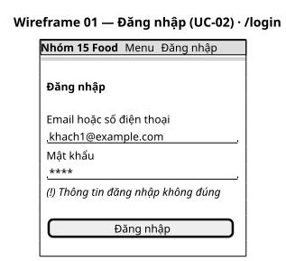
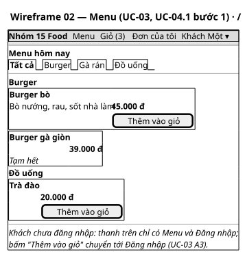
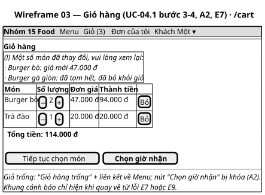
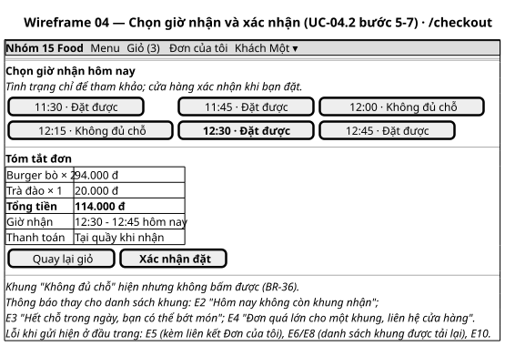
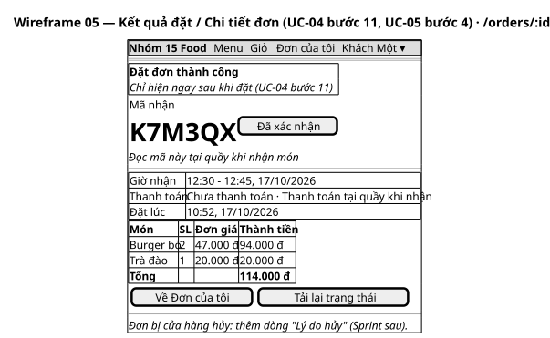
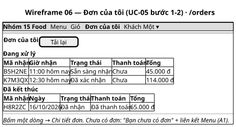
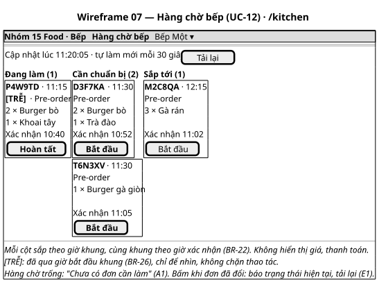
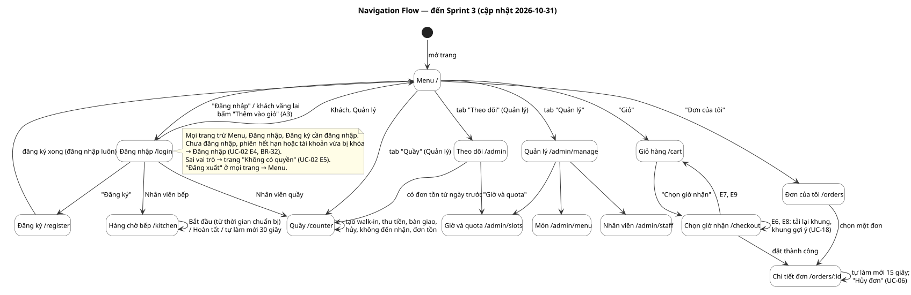

# UI Prototype
Trạng thái: Lập ở task T-11 (Sprint 1) ngày 2026-10-17 cho 7 màn hình Sprint 1. Đã qua một vòng góp ý của người dùng: bản phối màu v1 bị đánh giá là quá trơn, làm lại thành **prototype v2** theo phong cách người dùng chọn (mục 6). Người dùng đã chấp thuận prototype v2 ngày 2026-10-21 (mục 7).

Bước 14 của [quy trình IT3180](../../../00-References/IT3180_PROJECT_PROCESS.md): kiểm tra giao diện và luồng đi **trước khi** đầu tư code. Thứ tự: bố cục → wireframe đơn sắc → phối màu → navigation → đánh giá → sửa → bản được chấp thuận.

## Input
- Đặc tả [UC-02, UC-03, UC-04, UC-05, UC-12](../../02-Requirements/Use-Cases/README.md) mục 5 (luồng chính, A, E), [Activity Diagrams](../../02-Requirements/Activity-Diagrams/README.md).
- [Architecture](../Architecture/ARCHITECTURE.md) mục 5 (API: màn hình hiển thị được dữ liệu gì) và mục 6 (cấu trúc frontend).
- Quy tắc hiển thị: BR-34 (xem menu không cần đăng nhập), BR-36 (khung chỉ hiện "Đặt được/Không đủ chỗ"), UC-03 Ghi chú (không hiện điểm công việc), UC-12 Ghi chú (bếp không thấy giá).

Giao diện không thêm chức năng hay quy tắc nào ngoài đặc tả. Chỗ đặc tả để UI quyết định được ghi ở mục 2.

## 1. Danh sách màn hình
| # | Màn hình | Route | Vai trò | Use case | Wireframe |
|---|---|---|---|---|---|
| 01 | Đăng nhập | `/login` | Mọi người | UC-02 | [wf-01](wireframes/wf-01_dang-nhap.svg) |
| 02 | Menu | `/` | Mọi người | UC-03, UC-04 bước 1 | [wf-02](wireframes/wf-02_menu.svg) |
| 03 | Giỏ hàng | `/cart` | Khách | UC-04.1, A2, E7, E9 | [wf-03](wireframes/wf-03_gio-hang.svg) |
| 04 | Chọn giờ nhận và xác nhận | `/checkout` | Khách | UC-04.2 bước 5–7, E2–E6, E8, E10 | [wf-04](wireframes/wf-04_chon-khung.svg) |
| 05 | Chi tiết đơn / kết quả đặt | `/orders/:id` | Khách | UC-04 bước 11, UC-05 bước 4 | [wf-05](wireframes/wf-05_chi-tiet-don.svg) |
| 06 | Đơn của tôi | `/orders` | Khách | UC-05 bước 1–2, A1 | [wf-06](wireframes/wf-06_don-cua-toi.svg) |
| 07 | Hàng chờ bếp | `/kitchen` | Nhân viên bếp | UC-12 | [wf-07](wireframes/wf-07_hang-cho-bep.svg) |
| 08 | Đăng ký | `/register` | Khách vãng lai | UC-01 | Giao diện thật (Sprint 2), chưa vẽ wireframe |
| 09 | Quầy: thu tiền, bàn giao, walk-in, hủy, không đến nhận, đơn tồn | `/counter` | Quầy, quản lý | UC-07–UC-11 | Giao diện thật (Sprint 1–3, sửa 2026-10-31), chưa vẽ wireframe |
| 10 | Theo dõi hôm nay | `/admin` | Quản lý | UC-16 | Giao diện thật (Sprint 3), chưa vẽ wireframe |
| 11 | Quản lý (trang tổng) | `/admin/manage` | Quản lý | — | Danh sách liên kết tới 12–14 |
| 12 | Món và giá | `/admin/menu` | Quản lý | UC-13 | Giao diện thật (Sprint 2), chưa vẽ wireframe |
| 13 | Giờ mở cửa và lịch bếp (trước Sprint 4: quota) | `/admin/slots` | Quản lý | UC-14 | Giao diện thật (Sprint 2), chưa vẽ wireframe |
| 14 | Tài khoản nhân viên | `/admin/staff` | Quản lý | UC-15 | Giao diện thật (Sprint 3), chưa vẽ wireframe |
| — | Không có quyền | `/forbidden` | — | UC-02 E5 | Chỉ có trong prototype |

Nhân viên quầy và quản lý trong Sprint 1 chỉ dùng được Menu (UC-02 mục phân quyền), nên chưa có màn hình riêng.

## 2. Bố cục và các quyết định giao diện
**Bố cục chung (v2)**: màn của khách là một cột kiểu ứng dụng điện thoại, rộng tối đa 520 px, nằm giữa màn hình khi mở trên máy tính. Khách đặt từ thiết bị cá nhân (SRS B.1), nên thiết kế cho điện thoại trước.
- Thanh trên: tên cửa hàng và "Đặt trước · Tự đến lấy", biểu tượng giỏ có số món. Trang con có nút quay lại.
- Thanh tab ở đáy: Thực đơn, Đơn của tôi, Đăng xuất (khách vãng lai: Thực đơn, Đăng nhập).
- Thanh giỏ màu tối dính đáy trang thực đơn khi giỏ có món: số món, tổng tiền, nút "Xem giỏ".
- Nút hành động chính của Giỏ và Chọn giờ nhận dính ở đáy màn, luôn bấm được mà không phải cuộn.
- Hàng chờ bếp rộng tối đa 1240 px, ba cột cạnh nhau, chữ món và mã lớn để đọc từ xa: bếp thường dùng màn hình lớn hoặc máy tính bảng đặt cố định. Màn hẹp thì ba cột xếp chồng.

| Đặc tả để UI quyết định | Quyết định | Lý do |
|---|---|---|
| Màn hình chính từng vai trò (UC-02 bước 6) | Khách, quầy, quản lý → Menu; bếp → Hàng chờ bếp | Đó là việc đầu tiên mỗi vai trò cần làm trong Sprint 1 |
| Cách làm mới hàng chờ bếp (UC-12 bước 3) | Tự tải lại mỗi 30 giây, kèm nút "Tải lại" và giờ cập nhật | Đơn mới hiện ra mà bếp không phải bấm; 30 giây đủ nhanh so với khung 15 phút và nhẹ cho server. Đẩy từ server (WebSocket) để Sprint sau nếu cần |
| Kết quả đặt thành công (UC-04 bước 11) | Dùng lại màn Chi tiết đơn, thêm khung "Đặt đơn thành công" | Một màn hiển thị đơn thay vì hai; khách lưu được địa chỉ trang |
| Lỗi khi gửi đơn | E7, E9 → về Giỏ kèm khung cảnh báo; E6, E8 → ở lại, tải lại danh sách khung; E5, E10 → ở lại, báo lỗi, giữ giỏ | Theo đúng nơi quay về trong Activity Diagram UC-04 |
| Khung "Không đủ chỗ" | Vẫn hiện, xám, không bấm được | BR-36 |
| Món tạm hết | Ảnh xám, nhãn "Tạm hết", không có nút thêm | UC-03 bước 2, BR-04 |
| Thêm món vào giỏ (UC-04 bước 1–2) | Nút "+" tròn thêm ngay 1 phần; bấm vào dòng món mở bảng trượt từ đáy (ảnh lớn, mô tả, chọn số lượng, nút "Thêm vào giỏ · giá") | Hai cách cho hai nhu cầu: thêm nhanh và xem kỹ. Theo mẫu The Coffee House |
| Chọn khung giờ | Lưới nút giờ, nhóm theo giờ (11 giờ, 12 giờ…); khung hết chỗ bị gạch ngang | Dễ quét bằng mắt hơn danh sách dài |
| Mã nhận | Thẻ "vé" nền tối, mã 6 ký tự cỡ lớn, kèm thanh tiến trình 4 bước của đơn | Mã nhận là thứ khách cần đọc tại quầy (UC-05 bước 4) |
| Món không có ảnh | Ô màu kem với biểu tượng | Ảnh là tùy chọn (BR-01) |
| Khách vãng lai bấm "Thêm vào giỏ" | Chuyển tới Đăng nhập, món không tự thêm | UC-03 A3 |
| Nút thao tác chính của bếp | Đơn "Cần chuẩn bị" có nút Bắt đầu màu chính; đơn "Sắp tới" nút viền kèm "Cần chuẩn bị từ HH:mm · làm trước được" | Gợi ý thứ tự làm, vẫn cho làm trước lúc vắng (BR-21). Ngày 2026-10-31 từng đổi thành không cho làm trước; người dùng quyết định khôi phục vì giờ đông cần bếp đã làm sẵn |
| Trang đơn tự cập nhật (PB-14) | Hỏi lại mỗi 15 giây khi đơn chưa kết thúc; đơn vừa sẵn sàng thì hiện khung xanh "Đơn của bạn đã sẵn sàng" | Không dùng email/SMS; đơn giản, đủ cho cửa hàng nhỏ (Sprint 3) |
| Hủy đơn của khách | Nút "Hủy đơn" có bước xác nhận, kèm "Bạn có thể tự hủy tới HH:mm nếu cửa hàng chưa bắt đầu làm món"; đơn đã thanh toán không có nút, hiện "liên hệ cửa hàng" | UC-06, BR-23 sửa đổi 2026-10-31 |
| Hủy đơn của cửa hàng | Bấm "Hủy đơn" mới hiện ô lý do; nút xác nhận chỉ bật khi đã nhập | UC-11, lý do bắt buộc (BR-24) |
| Đơn quá hạn nhận, đơn tồn | Thẻ viền đỏ, nút "Không đến nhận"; đơn chưa kết thúc của ngày trước gom vào khung vàng "Đơn tồn từ ngày trước" ở đầu màn quầy, có ngày | UC-10; quyết định 2026-10-31 |
| Điều hướng của quản lý | Thanh tab: Thực đơn, Theo dõi, Quầy, Quản lý (Món, Giờ và quota, Nhân viên), Đăng xuất | Giữ thanh tab đáy gọn trên điện thoại (Sprint 3) |
| Màn "Giờ mở cửa và lịch bếp" (Sprint 4, PB-22) | Thêm ô "Làm trước tối đa (phút)", "Phần cho đặt trước (%)", "Tối đa đơn mỗi khung nhận"; ô quota đổi tên "Công suất bếp (điểm/15 phút)"; mỗi khung hiện "Bếp làm X/Y · nhận N đơn". Màn theo dõi dùng cùng nhãn. Thẻ đơn sắp tới ở màn bếp ghi "Theo lịch bếp: làm từ HH:mm · làm trước được" | Quản lý thấy bếp sẽ bận lúc nào chứ không chỉ khung nào đã nhận bao nhiêu; giao diện thật, chưa vẽ wireframe |
| Đơn trễ | Nhãn đỏ "TRỄ" và viền trái đỏ trên thẻ | BR-26: chỉ để nhìn, không chặn thao tác |

Màn 08–14 chỉ có giao diện thật, chưa vẽ wireframe đơn sắc hay đánh giá prototype riêng; dùng chung bảng màu và thành phần của màn 01–07. Navigation Flow (mục 5) đã vẽ lại cho mọi màn ngày 2026-10-31.

## 3. Wireframe đơn sắc
Vẽ bằng PlantUML Salt, chỉ có bố cục và nội dung, không màu. Dòng chữ nghiêng ở cuối mỗi hình mô tả trạng thái khác của cùng màn (trống, lỗi).

| | |
|---|---|
|  |  |
|  |  |
|  |  |

## 4. Bản phối màu
**v2 (hiện hành).** Hướng do người dùng chọn ngày 2026-10-17 sau khi xem thử các trang đặt món đang chạy: kết hợp **The Coffee House** (`order.thecoffeehouse.com`: khung app điện thoại, món dạng dòng có ảnh và nút "+", bảng thêm món trượt từ đáy, thanh tab đáy) và **Starbucks** (`starbucks.com/menu`: nhiều khoảng trắng, tiêu đề đậm, thanh màu tối dính đáy). Chỉ mượn cách bố trí, không dùng màu, logo hay hình ảnh của hai thương hiệu.

- **Màu**: cam đất làm màu chính (nút, giá, điểm nhấn), nền trắng và kem ấm, xanh rêu rất đậm cho thanh giỏ và thẻ mã nhận. Màu trạng thái dùng thống nhất ở mọi màn: xanh dương = đã xác nhận, vàng nâu = đang làm/cảnh báo, xanh lá = sẵn sàng/đặt được, đỏ = lỗi/trễ/hủy, xám = đã kết thúc/không chọn được.
- **Font**: Be Vietnam Pro (Google Fonts, giấy phép OFL), thiết kế riêng cho tiếng Việt nên dấu hiển thị đẹp. Trong code (T-13) cài qua npm (`@fontsource/be-vietnam-pro`) để không phụ thuộc mạng ngoài.
- **Hình khối**: góc bo lớn (16–24 px), bóng đổ nhẹ, biểu tượng nét mảnh tự vẽ bằng SVG.
- **Ảnh món**: prototype dùng ảnh từ Unsplash (giấy phép Unsplash, dùng tự do) chỉ để minh họa. Sản phẩm thật dùng ảnh của cửa hàng qua trường `image_url` của món (BR-01), không bắt buộc.

| Token (biến CSS) | Màu | Dùng cho |
|---|---|---|
| `--bg` | `#F7F5F2` | Nền ngoài khung app, khối tóm tắt |
| `--surface` | `#FFFFFF` | Nền khung app, thẻ |
| `--cream` | `#FFF4E6` | Ô ảnh của món không có ảnh |
| `--border` | `#ECE8E3` | Viền, đường kẻ |
| `--ink` / `--ink-2` / `--ink-3` | `#1C1917` / `#57534E` / `#6D6661` | Chữ chính / chữ phụ / chữ mờ |
| `--primary` / `-hover` | `#C2410C` / `#9A3412` | Nút chính, giá, khung giờ đang chọn |
| `--primary-soft` | `#FFEDD5` | Nền nút "+", mục đang chọn |
| `--dark` | `#1F2A24` | Thanh giỏ, thẻ mã nhận, đầu trang bếp |
| `--info` / `-bg` | `#1D4ED8` / `#DBEAFE` | Đã xác nhận |
| `--warning` / `-bg` | `#92400E` / `#FEF3C7` | Đang chuẩn bị, cảnh báo |
| `--success` / `-bg` | `#166534` / `#DCFCE7` | Sẵn sàng nhận, "Đặt được", thông báo thành công |
| `--danger` / `-bg` | `#B91C1C` / `#FEE2E2` | Lỗi, trễ, đã hủy |
| `--neutral` / `-bg` | `#44403C` / `#F5F5F4` | Đã nhận, không đến nhận, khung hết chỗ |

Độ tương phản theo WCAG 2.1, tính bằng script ngày 2026-10-17: mọi cặp chữ/nền dùng trong prototype ≥ 4,5:1 (mức AA). Thấp nhất là chữ cam trên nền nút "+" 4,52:1; chữ trắng trên nút chính 5,18:1; chữ mờ `--ink-3` trên nền `--bg` 5,18:1 (màu này được làm đậm hơn sau khi lần tính đầu chỉ đạt 4,41:1). Nút bị khóa không thuộc yêu cầu tương phản. Không dùng màu làm tín hiệu duy nhất: trạng thái luôn có chữ ("Đặt được", "Hết chỗ", "TRỄ").

**Prototype có màu, bấm thử được:** [prototype/index.html](prototype/index.html). Một file HTML, dữ liệu giả, không gọi backend; cần mạng để tải font và ảnh. Cách mở: double-click file, hoặc chạy `python -m http.server` trong thư mục `prototype` rồi mở `http://localhost:8000`. Nút "⚙ Prototype" ở góc dưới bên trái mở bảng điều khiển của prototype (không thuộc giao diện thật): đổi vai trò, chọn tình huống lỗi E2–E10, hàng chờ trống. Bộ biến màu được chép vào `frontend/src/index.css` ở T-13.

**v1** (thanh điều hướng trên, bảng đơn giản, không ảnh) còn trong lịch sử Git, commit `c3f4dec`.

**Wireframe ở mục 3 là bố cục v1.** Nội dung và luồng từng màn không đổi; v2 chỉ đổi cách trình bày (thanh tab đáy, bảng thêm món, thanh giỏ dính đáy, thẻ mã nhận). Khi người dùng chấp thuận hướng v2, cập nhật wireframe cho khớp.

## 5. Navigation Flow

Quy tắc chung (UC-02):
- Trang cần đăng nhập mà chưa đăng nhập hoặc phiên hết hạn → Đăng nhập, xong quay về trang đang mở (E4). Giỏ không mất (UC-04 E11).
- Sai vai trò → "Không có quyền" (E5). Ẩn liên kết trên thanh điều hướng chỉ để gọn; quyền thật kiểm ở backend.
- Đăng xuất → Menu.

## 6. Đánh giá prototype
Theo 5 câu hỏi của nguồn.

**Vòng 1 (2026-10-17), góp ý của người dùng:** wireframe và bản phối màu v1 "rất xấu, không thể chấp nhận". Người dùng xem thử các trang đặt món đang chạy (ShopeeFood, GrabFood, KFC, McDonald's, Lotteria, Jollibee, Domino's, The Coffee House, Starbucks, Chipotle, sweetgreen, Pizza 4P's) và chọn hướng The Coffee House kết hợp Starbucks. Đã làm lại thành v2 (mục 2, 4). Nội dung, luồng và quy tắc nghiệp vụ không đổi.

**Vòng 2 (v2): chưa đánh giá.** Cột "Tự kiểm" là AI đối chiếu prototype v2 với đặc tả, không thay cho đánh giá của người dùng.

| Câu hỏi | Tự kiểm v2 (AI, 2026-10-17) | Đánh giá của người dùng |
|---|---|---|
| Có đáp ứng yêu cầu không? | Mọi luồng chính, A, E của UC-02, 03, 04, 05, 12 có chỗ hiển thị (bảng mục 1, 2). Đã bấm thử trong trình duyệt: thêm món bằng nút "+" và bảng thêm món, đặt thành công, E4, E7, E8, bếp bắt đầu đơn, chặn khách vãng lai thêm món, chặn bếp vào Đơn của tôi | Chưa đánh giá |
| Thông tin/chức năng có dễ tìm không? | Giỏ luôn thấy ở thanh trên và thanh giỏ đáy; thanh tab đáy cho hai việc chính; mã nhận là chữ lớn nhất trên chi tiết đơn | Chưa đánh giá |
| Bố cục có hợp lý không? | Khách một cột kiểu app, không cuộn ngang ở 375 px (đo bằng JS); nút chính dính đáy; bếp ba cột ở 1280 px, xếp chồng khi hẹp | Chưa đánh giá |
| UI có dễ đọc không? | Tương phản AA (mục 4); font Be Vietnam Pro; mã nhận chữ đơn cách cỡ lớn | Chưa đánh giá |
| Thao tác có dễ không? | Đặt một món: "+" → Xem giỏ → Chọn giờ nhận → chọn khung → Xác nhận đặt (5 lần bấm). Nút bấm cao ≥ 32 px | Chưa đánh giá |

Cách đánh giá đề xuất: mở prototype trên điện thoại và máy tính, đóng vai khách đặt một đơn và vai bếp xử lý đơn đó, thử ít nhất 3 tình huống lỗi; ghi điều chưa hợp lý vào cột cuối. Có góp ý thì sửa tiếp (Feedback → Redesign) rồi đánh giá lại.

## 7. Phiên bản được chấp thuận
Ngày 2026-10-21, người dùng xem và bấm thử prototype v2 (`prototype/index.html`, commit `be36609`), nhận xét "khá ổn", rồi duyệt cùng các phần thiết kế khác khi merge PR #7. Đây là bản được chấp thuận, làm căn cứ cho T-13, T-15, T-17, T-19, T-20, T-21.

Đây là sự chấp thuận của một người dùng (nhóm trưởng), không có đánh giá độc lập của người dùng cuối hoặc giảng viên. Wireframe đơn sắc ở mục 3 vẫn là bố cục v1, chưa vẽ lại; khi cần dùng wireframe làm tài liệu thì cập nhật cho khớp v2.

## Công cụ
Wireframe (`wireframes/*.puml`, cú pháp Salt) và navigation (`navigation-flow.puml`) vẽ bằng PlantUML; cách render như [Analysis Model](../Analysis-Model/README.md) mục Công cụ (làm trong thư mục `UI-Prototype` và `UI-Prototype/wireframes`; wireframe không `!include` file kiểu nên không cần mount thư mục cha).

## Output chuyển giao
- T-13, T-15, T-17, T-19, T-20, T-21: route, nội dung từng màn, câu thông báo lỗi, bảng màu.
- T-23: mỗi trạng thái lỗi trong prototype là một tình huống black-box test.
