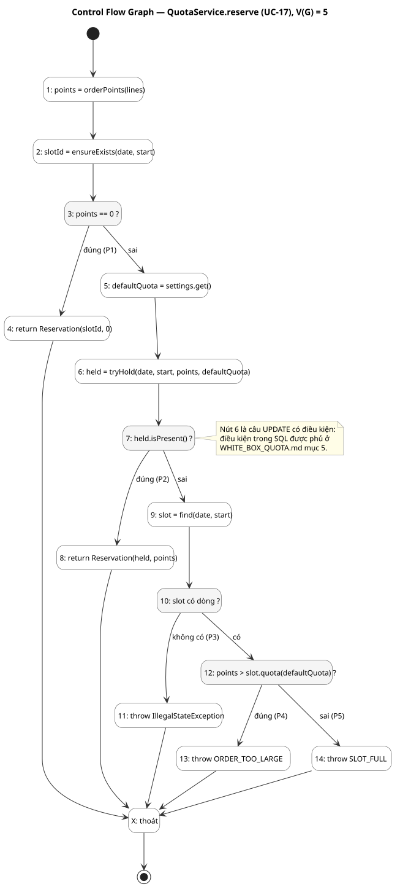

# White-box Test — Logic giữ quota (UC-17)
Trạng thái: Thiết kế ở task T-24 (Sprint 1) ngày 2026-10-24 cho logic giữ quota (PB-05); các test đã cài đặt và đã chạy, kết quả ở [Test Results](../Test-Results/README.md). Người dùng chưa review.

Theo Bước 16 của [quy trình IT3180](../../../00-References/IT3180_PROJECT_PROCESS.md): đọc code → xây Control Flow Graph → xác định đường thi hành → chọn dữ liệu → thiết kế test → chạy → ghi kết quả. Black-box của cùng chức năng nằm ở [BLACK_BOX_TEST_CASES.md](BLACK_BOX_TEST_CASES.md) (TC-ORD, TC-CON); tài liệu này kiểm chứng **từng nhánh trong code**.

## 1. Đối tượng kiểm thử
Mã nguồn ở [`slot/`](../../../03-SourceCodes/backend/src/main/java/vn/nhom15/preorder/slot/) (phiên bản trong PR #9, T-16). Chọn phần có logic quyết định của UC-17; các lớp chỉ chứa dữ liệu (`QuotaReservation`, `StoreSettings`) không có nhánh nên không thiết kế đường.

| Đơn vị | Vai trò | Số điểm quyết định | V(G) |
|---|---|---|---|
| `QuotaService.reserve` | Điều phối UC-17: đơn 0 điểm, giữ quota, phân biệt quá lớn và hết chỗ | 4 | **5** |
| `QuotaService.orderPoints` | Σ điểm × số lượng (BR-08) | 1 (vòng lặp) | 2 |
| `QuotaLine` (hàm khởi tạo) | Từ chối điểm âm và số lượng nhỏ hơn 1 | 2 | 3 |
| `TimeSlot.quota` | Quota riêng nếu có, ngược lại quota mặc định (BR-07) | 1 | 2 |
| `StoreSettingsRepository.get` | Thiếu dòng cấu hình là lỗi cài đặt | 1 | 2 |
| `SlotRepository.tryHold` | Điều kiện trong câu SQL `UPDATE` (mục 5) | điều kiện trong SQL | — |
| `SlotRepository.ensureExists` | `INSERT ... ON CONFLICT DO NOTHING` rồi `SELECT` | nhánh nằm trong database | — |

V(G) là độ phức tạp chu trình: số điểm quyết định cộng một, cũng là số đường độc lập tối thiểu cần phủ.

## 2. Control Flow Graph của `QuotaService.reserve`


| Nút | Mã (rút gọn) | Quy tắc |
|---|---|---|
| 1 | `points = orderPoints(lines)` | BR-08 |
| 2 | `slotId = ensureExists(date, start)` | Khung có dòng để đơn gắn vào |
| 3 | `if (points == 0)` | BR-13 |
| 4 | `return new QuotaReservation(slotId, 0)` | Đơn 0 điểm không chiếm quota |
| 5, 6 | đọc quota mặc định; `tryHold(...)` | BR-09, NFR-01 |
| 7 | `if (held.isPresent())` | Giữ được |
| 8 | `return new QuotaReservation(held, points)` | UC-17 bước 6 |
| 9, 10 | `find(...)`, kiểm tra có dòng (`orElseThrow`) | Không thể xảy ra nếu database đúng |
| 11 | `throw IllegalStateException` | Lỗi hệ thống, không được báo nhầm thành "hết chỗ" |
| 12 | `if (points > slot.quota(defaultQuota))` | BR-12 |
| 13 | `throw ORDER_TOO_LARGE` | UC-17 E1 |
| 14 | `throw SLOT_FULL` | UC-17 E2 |

Kiểm tra V(G): 4 điểm quyết định (nút 3, 7, 10, 12) + 1 = 5. Theo công thức E − N + 2: 13 cạnh trong thân hàm và 5 cạnh về nút thoát, tổng E = 18; N = 15 nút (14 nút và nút thoát); 18 − 15 + 2 = 5. Hai cách ra cùng kết quả.

## 3. Đường độc lập và test
| Đường | Chuỗi nút | Dữ liệu vào | Kết quả mong đợi | Test (lớp#phương thức) |
|---|---|---|---|---|
| **P1** | 1-2-3-4 | Đơn 0 điểm (ví dụ chỉ đồ uống) | Trả mã khung, 0 điểm; không gọi `tryHold`; điểm đang giữ không đổi kể cả khi khung đã đầy | `QuotaServiceTest#zeroPointOrderDoesNotTouchQuota`; `QuotaDatabaseTest#zeroPointOrderIsAcceptedEvenWhenTheSlotIsFull` |
| **P2** | 1-2-3-5-6-7-8 | Đơn 8 điểm, khung còn chỗ | Trả khung và 8 điểm; điểm đang giữ tăng 8 | `QuotaServiceTest#successReturnsTheHeldSlotAndPoints`; `QuotaDatabaseTest#reserveCreatesTheSlotRowAndHoldsThePoints`, `#ordersAreAcceptedUpToExactlyTheQuotaThenRejected` |
| **P3** | 1-2-3-5-6-7-9-10-11 | `tryHold` rỗng và `find` rỗng (mô phỏng database lỗi) | `IllegalStateException`, không phải `SLOT_FULL` | `QuotaServiceTest#slotMissingRightAfterBeingCreatedIsAnInternalError` |
| **P4** | 1-2-3-5-6-7-9-10-12-13 | Đơn 21 điểm, quota khung 20; hoặc đơn 8 điểm, quota riêng 6 | `ORDER_TOO_LARGE`; điểm đang giữ không đổi | `QuotaServiceTest#orderLargerThanTheWholeSlotReportsTooLarge`, `#slotsOwnQuotaTakesPrecedenceWhenDecidingTooLarge`; `QuotaDatabaseTest#orderLargerThanTheSlotQuotaIsTooLargeNotFull`, `#slotQuotaOverrideTakesPrecedenceOverTheDefault` |
| **P5** | 1-2-3-5-6-7-9-10-12-14 | Đơn 8 điểm, quota 20, đang giữ 15 | `SLOT_FULL`; điểm đang giữ không đổi | `QuotaServiceTest#notEnoughRemainingQuotaReportsSlotFull`; `QuotaDatabaseTest#ordersAreAcceptedUpToExactlyTheQuotaThenRejected` |

**Các đơn vị nhỏ**
| Đơn vị | Đường | Dữ liệu vào | Kết quả mong đợi | Test |
|---|---|---|---|---|
| `orderPoints` | Không lặp lần nào | Danh sách rỗng | 0 | `QuotaServiceTest#orderPointsIsSumOfPointsTimesQuantity` |
| | Lặp một hay nhiều lần | (3×2) + (1×4) + (0×5) | 10 | cùng test |
| | Số học tràn (ngầm) | 2 dòng cộng vượt `int`; một dòng nhân vượt `int` | `ArithmeticException`, không cho điểm nhỏ sai | `QuotaServiceTest#sumOverflowIsReportedInsteadOfWrappingAround` |
| `QuotaLine` | Hợp lệ, giá trị biên | Điểm 0, số lượng 1 | Chấp nhận | `QuotaServiceTest#boundaryValuesOfALineAreAccepted` |
| | Điểm âm | (−1, 1) | `IllegalArgumentException` | `QuotaServiceTest#invalidLinesAreRejectedEarly` |
| | Số lượng nhỏ hơn 1 | (2, 0) | `IllegalArgumentException` | cùng test |
| `TimeSlot.quota` | Có quota riêng | 12, mặc định 20 | 12 | `QuotaServiceTest#timeSlotQuotaUsesOverrideOtherwiseDefault` |
| | Không có | null, mặc định 20 | 20 | cùng test |
| `StoreSettingsRepository.get` | Có dòng cấu hình | Dữ liệu mẫu | Trả giờ mở cửa và quota | `QuotaDatabaseTest` (mọi test dùng dữ liệu mẫu) |
| | Thiếu dòng | Database trống | `IllegalStateException` | `SlotRepositoryTest#storeSettingsWithoutARowIsAnInstallationError` |

## 4. Độ phủ thực đo
Đo bằng JaCoCo khi chạy `./mvnw verify` (báo cáo ở `target/site/jacoco/`), ngày 2026-10-24:

| Lớp | Dòng | Nhánh |
|---|---|---|
| `QuotaService` | 24/24 | 8/8 |
| `QuotaLine` | 6/6 | 4/4 |
| `TimeSlot` | 2/2 | 2/2 |
| `StoreSettingsRepository` | 11/11 | 2/2 |
| `SlotRepository` | 19/19 | không có nhánh Java (nhánh nằm trong SQL, mục 5) |

Phủ nhánh 100% cho các đơn vị có logic quyết định. Độ phủ chỉ cho biết dòng và nhánh **đã được chạy**, không chứng minh kết quả đúng; tính đúng do các giá trị mong đợi ở mục 3 và mục 5 bảo đảm.

## 5. Điều kiện trong câu SQL giữ quota
Câu `UPDATE` ở `SlotRepository.tryHold` là nơi quyết định thật sự (BR-09):

```sql
UPDATE time_slots SET held_points = held_points + :p
WHERE slot_date = :d AND start_time = :s
  AND held_points + :p <= COALESCE(quota_override, :defaultQuota)
```

Điều kiện chứa hai yếu tố: có quota riêng hay không (`COALESCE`), và so sánh `≤`. Phủ bằng bảng giá trị biên (`SlotRepositoryTest#holdFollowsTheQuotaInequality`, 10 dòng):

| # | Quota riêng | Đang giữ | Điểm đơn | Mặc định | Tổng | Quota hiệu lực | Giữ được | Ý nghĩa |
|---|---|---|---|---|---|---|---|---|
| 1 | không | 0 | 20 | 20 | 20 | 20 | có | Đúng bằng quota (≤) |
| 2 | không | 0 | 21 | 20 | 21 | 20 | không | Hơn một điểm |
| 3 | không | 10 | 10 | 20 | 20 | 20 | có | Còn lại đúng bằng điểm đơn |
| 4 | không | 10 | 11 | 20 | 21 | 20 | không | Còn lại thiếu một điểm |
| 5 | không | 19 | 1 | 20 | 20 | 20 | có | Điểm cuối cùng của khung |
| 6 | 5 | 0 | 5 | 20 | 5 | 5 | có | Quota riêng nhỏ hơn mặc định |
| 7 | 5 | 0 | 6 | 20 | 6 | 5 | không | Vượt quota riêng dù chưa vượt mặc định |
| 8 | 30 | 25 | 5 | 20 | 30 | 30 | có | Quota riêng lớn hơn mặc định |
| 9 | 30 | 25 | 6 | 20 | 31 | 30 | không | Vượt quota riêng |
| 10 | 0 | 0 | 1 | 20 | 1 | 0 | không | Quota riêng bằng 0: khung đóng |

Mỗi dòng còn kiểm tra điểm đang giữ **chỉ tăng khi giữ được**. Thêm: khung chưa có dòng thì không giữ được (`#holdOnASlotWithoutARowGrantsNothing`); `ensureExists` tạo một lần rồi trả đúng dòng đó (`#ensureExistsCreatesOnceAndReturnsTheSameRowAfterwards`).

## 6. Tương tác đồng thời (nhánh nằm giữa các giao dịch)
Control Flow Graph của một lời gọi không thể hiện việc nhiều giao dịch xen kẽ. Các kịch bản xen kẽ rủi ro được kiểm riêng, trên PostgreSQL thật:

| Kịch bản xen kẽ | Rủi ro | Test |
|---|---|---|
| Hai giao dịch cùng tạo dòng khung chưa có | Hai dòng trùng, hoặc một giao dịch lỗi | `QuotaDatabaseTest#concurrentFirstUseOfANewSlotCreatesOneRowAndNeverOversells` |
| Hai giao dịch cùng thấy "còn chỗ" rồi cùng cộng | Vượt quota (NFR-01) | `#fiftyConcurrentOrdersNeverExceedTheQuota` (50 đơn × 3 điểm, quota 20: đúng 6 đơn); `#concurrentOrdersOfDifferentSizesKeepHeldPointsConsistent` (60 đơn ngẫu nhiên) |
| Giao dịch gọi lỗi sau khi đã giữ quota | Quota bị giữ mà không có đơn (BR-10) | `#holdIsUndoneWhenTheCallingTransactionFailsAfterReserving` |
| Gọi `reserve` ngoài giao dịch | Giữ quota không thể hoàn lại | `#reserveRefusesToRunOutsideATransaction` |
| Mã nguồn sai nhưng database vẫn phải chặn | Điểm đang giữ vượt quota riêng | `#databaseConstraintBlocksOverbookingEvenIfCodeIsWrong` |

## 7. Giới hạn
- Kết quả đo độ phủ chỉ cho logic quota. Các phần khác (`GlobalExceptionHandler`, một nhánh của `AuthController`) có nhánh chưa được phủ, ghi nhận để xử lý khi viết test cho API tương ứng.
- Chưa có white-box cho đặt đơn (`PlaceOrderService`, T-18) và chuyển trạng thái đơn (`OrderStatusService`, T-22); thiết kế bổ sung khi code có.
- Test đồng thời trong Sprint 1 là bản rút gọn ở tầng dịch vụ; kiểm chứng đầy đủ NFR-01 qua API (50 yêu cầu) ở Sprint 2.

## Công cụ
Sơ đồ vẽ bằng PlantUML (`cfg_QuotaService_reserve.puml`); cách render như [Analysis Model](../../03-Design/Analysis-Model/README.md) mục Công cụ. Độ phủ: JaCoCo `0.8.15` cấu hình trong `backend/pom.xml`, chạy cùng `./mvnw verify`.
